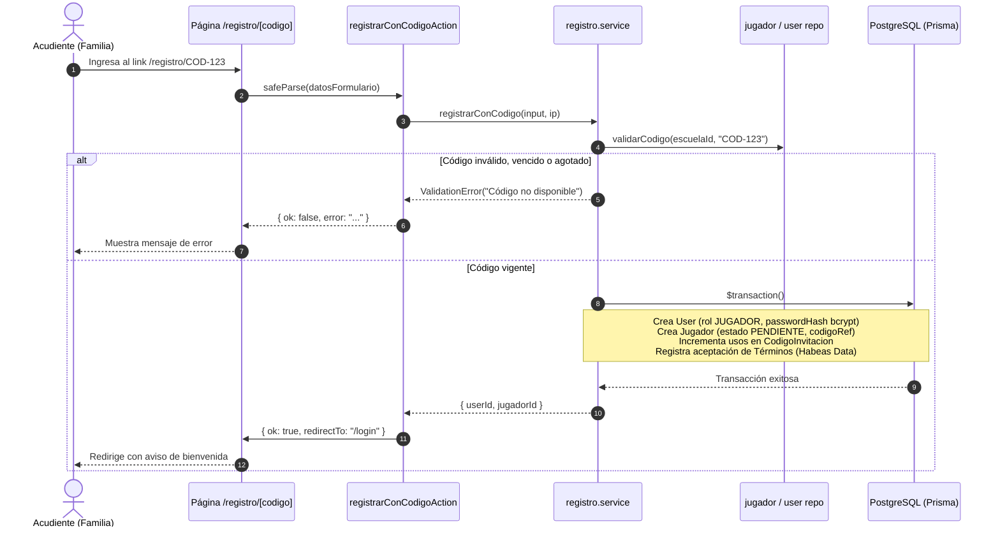
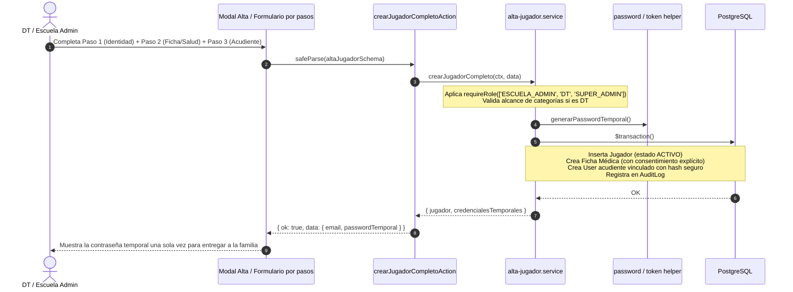
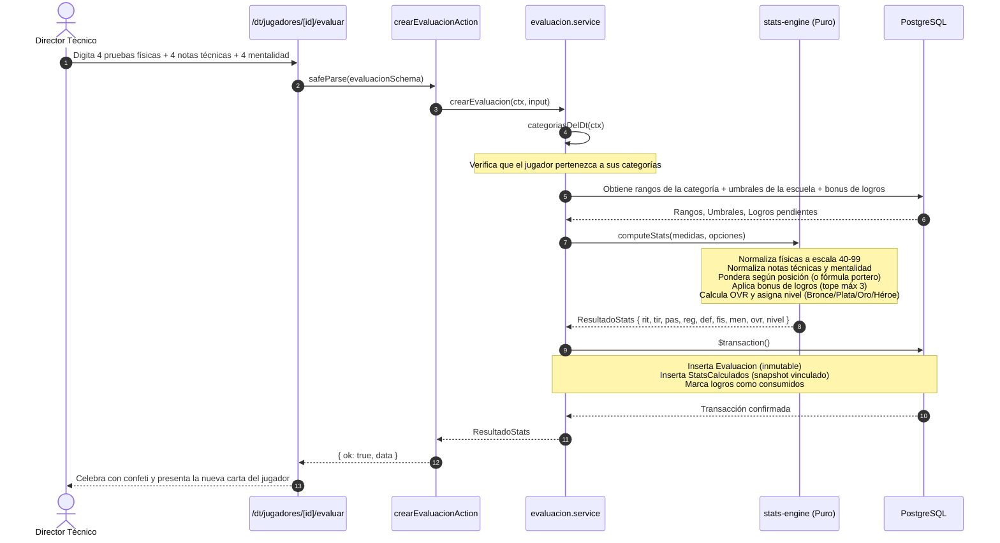
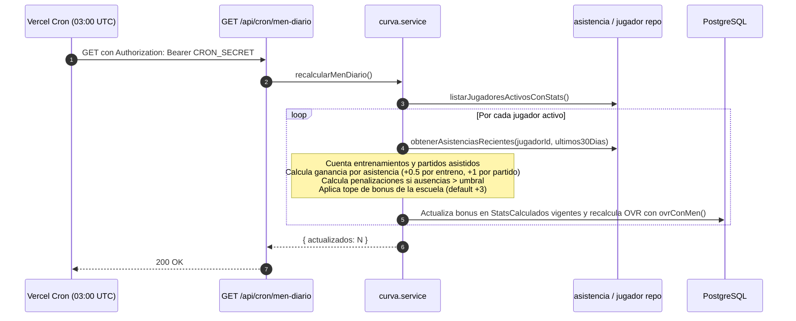
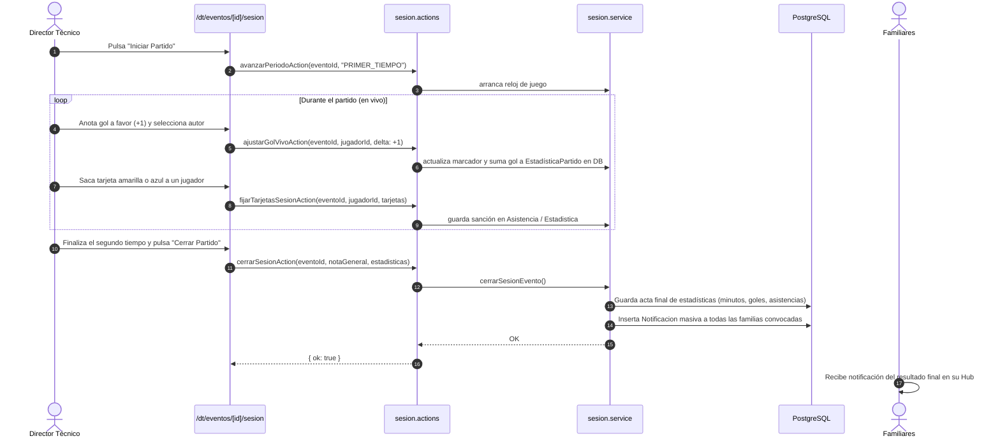
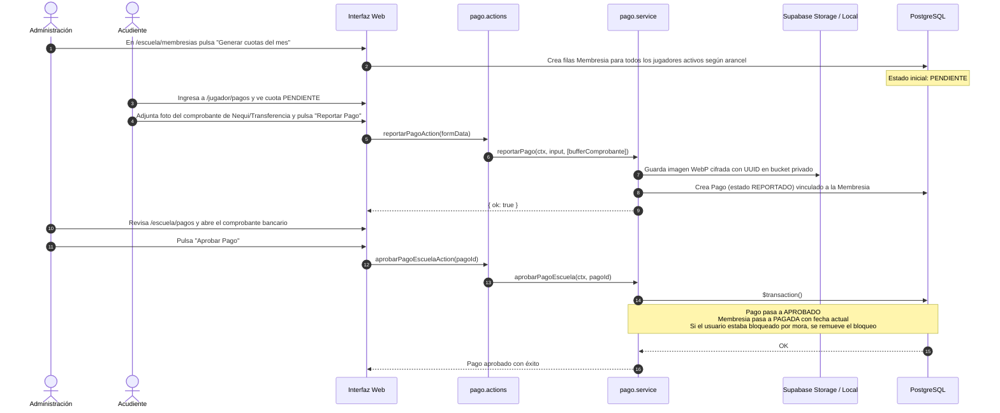
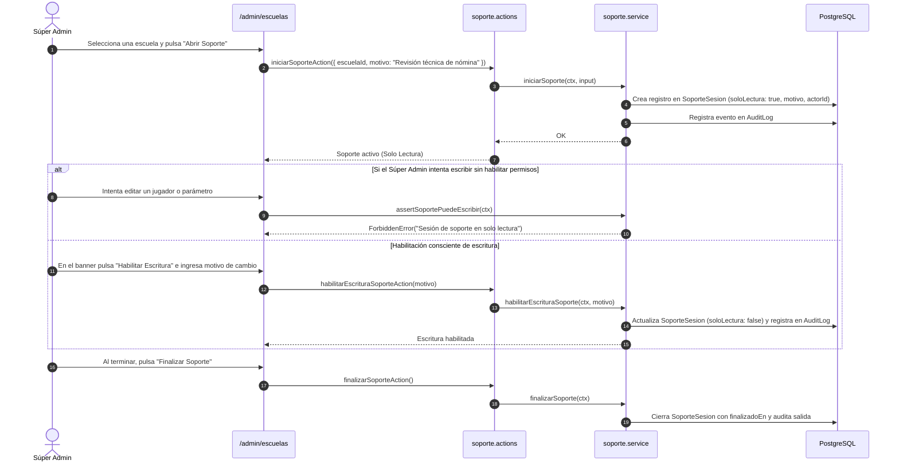
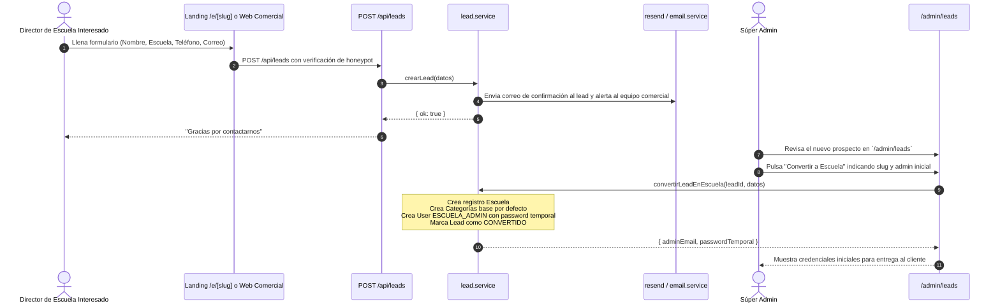

# Flujos de Punta a Punta

Este documento describe los procesos operativos clave de **Fútbol Career Mode** mediante diagramas de secuencia y estados en sintaxis Mermaid, detallando la interacción entre el usuario, la interfaz de usuario (UI), las Server Actions, la capa de servicios de dominio, los repositorios y la base de datos PostgreSQL.

---

## 1. Flujo: Registro de Familia con Código de Invitación

Permite a un nuevo acudiente incorporarse a la escuela y registrar a su hijo/a utilizando un código emitido por la administración.

---

## 2. Flujo: Alta Asistida de Jugador (por DT o Escuela)

Permite al club dar de alta a un menor de forma asistida en la cancha o en la oficina administrativa, generando credenciales temporales para la familia.

---

## 3. Flujo: Evaluación Deportiva y Nacimiento de la Carta

El núcleo de la gamificación: el entrenador toma mediciones reales, el motor matemático calcula los atributos y nace el cromo virtual.

---

## 4. Flujo: Curva de Desarrollo y Recálculo Diario de Mentalidad (MEN)

Muestra cómo la disciplina y la asistencia real en campo modifican el atributo MEN diariamente sin alterar las notas físicas o técnicas.

---

## 5. Flujo: Modo Sesión — Partido en Vivo y Cierre

Conducción interactiva de un partido oficial desde el dispositivo móvil del entrenador.

---

## 6. Flujo: Cobranza, Reporte de Pago y Desbloqueo por Mora

Gestión del ciclo económico del club deportivo y conciliación bancaria.

---

## 7. Flujo: Sesión de Soporte del Súper Administrador (M2)

Garantía de privacidad de menores: el administrador de la plataforma nunca accede a los datos de una escuela sin una sesión formalmente justificada y auditada.

---

## 8. Flujo: Captura de Leads y Conversión a Escuela

Ingreso de nuevas academias a la plataforma a través de la landing pública.

