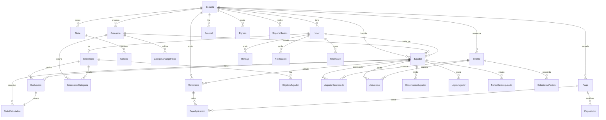

# Modelo de Datos

## 1. Diagrama Entidad-Relación (ER)

A continuación se presenta el diagrama general de las principales entidades del negocio y sus relaciones en la base de datos PostgreSQL mediante Prisma ORM:

---

## 2. Glosario Exhaustivo de Entidades

La base de datos contiene **45 modelos** organizados por dominios de negocio:

### Dominio 1: Identidad, Seguridad y Soporte

1. **`User`**: Cuentas de acceso a la plataforma. Almacena correo (`email`), contraseña con hash bcrypt (`passwordHash`), nombre completo, rol (`SUPER_ADMIN`, `ESCUELA_ADMIN`, `DT`, `JUGADOR`), teléfono de contacto y los datos fiscales opcionales del acudiente (tipo y número de documento, dirección). Controla el estado de activación (`activo`), verificación de correo (`emailVerificado`) y los flags de bloqueo por mora o disciplina (`bloqueado`, `bloqueoTipo`, `bloqueoMensaje`).
2. **`TokenAuth`**: Tokens criptográficos efímeros de un solo uso. Almacena el hash SHA-256 del token (`tokenHash`) para flujos de recuperación de clave (`RECUPERACION`), activación (`SET_PASSWORD`), verificación de email (`VERIFICACION_EMAIL`), código OTP (`OTP`) y cambio de dirección de correo (`CAMBIO_EMAIL`). Controla fecha de expiración (`expiraEn`) y contador de intentos fallidos anti-fuerza-bruta (`intentos`).
3. **`SoporteSesion`**: Registro de sesiones de asistencia técnica del `SUPER_ADMIN` sobre una escuela puntual. Almacena el ID del administrador, la escuela intervenida, el motivo auditado, si la sesión opera en modo solo lectura (`soloLectura`) y las marcas de tiempo de inicio y finalización (`finalizadoEn`).
4. **`AuditLog`**: Registro inmutable de eventos sensibles de seguridad, privacidad y modificaciones operativas. Captura el actor (`actorId`, `actorRol`), la acción (`LOGIN`, `CREAR_EVALUACION`, `EXPORT_CONTACTOS`, `EDITAR_FICHA_MEDICA`, etc.), la entidad afectada (`entidad`, `entidadId`), el tenant (`escuelaId`), la dirección IP y el motivo obligatorio en intervenciones de soporte.

### Dominio 2: Organización Escolar e Infraestructura

5. **`Escuela`**: Tenant central del sistema. Modela un club o academia deportiva. Contiene nombre, identificador amigable (`slug`), código humano para soporte (`codigoRef`), escudo (`logoUrl`), color primario para personalización white-label (`colorPrimario`), frecuencia de evaluación en días (`frecuenciaEvaluacionDias`), tope de bonus entre evaluaciones y configuración de su landing pública (`landingPublicada`, `landingTitular`, `landingDescripcion`, `landingHeroId`, redes de contacto).
6. **`Sede`**: Complejo o predio deportivo perteneciente a una escuela (ej. "Sede Norte", "Campus Campestre").
7. **`Cancha`**: Terreno de juego específico dentro de una sede (ej. "Cancha 1 Sintética", "Cancha Fútbol 8"). Vinculada a los eventos y entrenamientos.
8. **`Categoria`**: División deportiva de la escuela (ej. "Sub-10 A", "Iniciación"). Puede estar acotada por años de nacimiento (`anioDesde`, `anioHasta`) o ser de edad abierta (`sinEdad: true`).
9. **`CategoriaRangoFisico`**: Calibración física específica por categoría. Almacena los valores mínimos y máximos esperados para las 4 pruebas físicas (Sprint 30m, Salto vertical, Agilidad Illinois y Yo-Yo test), permitiendo que una categoría Sub-12 de alta competencia tenga un baremo más exigente que una formativa recreativa.
10. **`Staff`**: Colaboradores institucionales que no son directores técnicos (preparadores físicos, fisioterapeutas, psicólogos, secretarios). Almacena rol interno, teléfono y estado activo.
11. **`CodigoInvitacion`**: Token de registro alfanumérico emitido por la escuela para una categoría determinada. Controla la cantidad máxima de usos permitidos (`usosMaximos`), los usos consumidos (`usos`) y la fecha límite de vigencia (`expiraEn`).

### Dominio 3: Cuerpo Técnico y Deportistas

12. **`Entrenador`**: Perfil deportivo del director técnico. Vinculado 1 a 1 con un `User` de rol `DT`.
13. **`EntrenadorCategoria`**: Tabla intermedia de asignación de categorías a un entrenador. Define el alcance operativo del DT (`dt-scope`).
14. **`Jugador`**: Registro central del deportista menor de edad. Contiene nombre, apellido, fecha de nacimiento, género (`M`, `F`, `X`, `null`), posición táctica (`POR`, `DEF`, `MED`, `DEL`), dorsal, código público del jugador (`codigoJugador`), código de referencia (`codigoRef`), estado (`ACTIVO`, `INACTIVO`, `PENDIENTE`, `ELIMINADO`), foto WebP (`fotoUrl`), configuración del avatar DiceBear (`avatarConfig`) y la bandera de consentimiento explícito de uso de imagen (`consentimientoFoto`).
15. **Ficha Médica (en `Jugador`)**: Almacena datos sensibles bajo Habeas Data: tipo y documento de identidad del menor, EPS, grupo sanguíneo y factor RH, alergias, condiciones médicas, fecha de vencimiento del apto médico deportivo, contacto de emergencia (nombre, parentesco, teléfono), autorización de traslado en ambulancia y la bandera obligatoria de consentimiento firmado por los padres (`autorizaDatosSalud`).

### Dominio 4: Evaluaciones Deportivas y Motor de Stats

16. **`Evaluacion`**: Acta inmutable de una jornada de medición efectuada por un DT sobre un jugador. Almacena las 4 medidas físicas crudas (Sprint en segundos, Salto en cm, Agilidad en segundos, Yo-Yo en nivel) y las 8 notas técnicas y de mentalidad en escala 1 a 10, junto a las observaciones redactadas para la familia y la bandera de anulación (`anulada`).
17. **`StatsCalculados`**: Snapshot de atributos derivado matemáticamente a partir de una `Evaluacion`. Contiene los 6 stats de carta redondeados entre 1 y 99 (`rit`, `tir`, `pas`, `reg`, `def`, `fis`), el sello de mentalidad (`men`), la valoración general (`ovr`), el nivel asignado (`BRONCE`, `PLATA`, `ORO`, `HEROE`), los puntos de bonus consumidos y la versión de la fórmula matemática ejecutada (`versionFormula`).

### Dominio 5: Operatoria Deportiva y Eventos

18. **`Evento`**: Actividad deportiva programada en el calendario. Tipos: `ENTRENAMIENTO`, `PARTIDO`, `TORNEO`, `OTRO`. Almacena título, categoría, cancha asignada, rival (en partidos), condición de localía (`esLocal`), fecha y hora de inicio y fin, notas y estado de la sesión (`PROGRAMADO`, `EN_CURSO`, `FINALIZADO`, `CANCELADO`).
19. **`JugadorConvocado`**: Lista de citación de un menor a un evento puntual. Registra la confirmación de asistencia por parte de la familia (`PENDIENTE`, `CONFIRMADO`, `RECHAZADO`).
20. **`Asistencia`**: Registro de presencia efectiva en campo. Almacena si el jugador estuvo presente (`presente`), si su falta fue justificada (`justificado`) y las sanciones disciplinarias recibidas en cancha (tarjetas amarillas, rojas y azules).
21. **`EstadisticaPartido`**: Acta de rendimiento individual en un partido finalizado. Almacena minutos disputados, goles marcados y asistencias brindadas.
22. **`ObservacionJugador`**: Nota pedagógica redactada por el DT durante el Modo Sesión. Puede marcarse como visible para los padres (`visiblePadre: true`) o mantenerse confidencial para el cuerpo técnico.
23. **`ProgresoSemanal`**: Calificación formativa periódica de hábitos fuera de la cancha (nutrición, hidratación, descanso y disciplina). Puede ser calificada por el DT o por el acudiente.
24. **`ObjetivoJugador`**: Meta deportiva fijada a un jugador (ej. alcanzar stat meta en una fecha límite). Controla si fue alcanzado o continúa pendiente.

### Dominio 6: Comunicación y Gamificación

25. **`Conversacion`**: Canal de mensajería privada 1 a 1 entre el cuerpo técnico y la familia de un jugador puntual.
26. **`Mensaje`**: Mensaje de texto dentro de una conversación, con marcas de autor y fecha de lectura.
27. **`Anuncio`**: Comunicado oficial emitido por la escuela o el DT. Puede ser institucional para todo el club o restringido a una categoría, con opción de publicación directa en la app de la familia.
28. **`Notificacion`**: Alerta individual despachada a un usuario (convocatorias, resultados de partidos, cuotas emitidas, recordatorios). Controla estado leído/no leído y fecha de descarte.
29. **`Logro`**: Catálogo de insignias y trofeos. Puede ser de tipo HITO (honorífico) o BONUS (suma de +1 a +3 puntos a un stat en la siguiente evaluación deportiva).
30. **`LogroEscuela`**: Configuración de disponibilidad de un logro global para una escuela deportiva puntual, con programación de ventanas de fechas.
31. **`LogroJugador`**: Insignia otorgada a un menor, registrando fecha de concesión y si su bonus ya fue consumido en una evaluación.
32. **`FondoCarta`**: Catálogo de estilos visuales de carta (diseños gráficos y reglas CSS de efectos holográficos, chispas o brillos) y sus condiciones de desbloqueo.
33. **`FondoDesbloqueado`**: Fondos que un jugador ha ganado y tiene disponibles en su armario para equipar en su cromo virtual.

### Dominio 7: Cobranzas y Finanzas

34. **`ConceptoCobro`**: Tipos de cobro admitidos por la escuela (Mensualidad, Matrícula, Torneo, Uniformes, etc.).
35. **`Arancel`**: Matriz de precios fijados por categoría y concepto, con control de vigencia desde una fecha determinada para programación de aumentos.
36. **`DescuentoRegla`**: Fórmulas de exención económica automática (segundo hermano, beca deportiva, pronto pago).
37. **`JugadorDescuento`**: Asignación de una regla de descuento a un menor específico.
38. **`Membresia`**: Cuenta por cobrar emitida a un jugador para un período mensual (`YYYY-MM`) y concepto específico. Almacena monto bruto, descuento aplicado, valor neto, estado (`PENDIENTE`, `PAGADA`, `VENCIDA`) y fecha de cancelación.
39. **`Pago`**: Transacción de recaudo económico. Puede ser de origen `FAMILIA` (reportado por el acudiente) o `ESCUELA` (cobrado en ventanilla). Controla estado (`REPORTADO`, `APROBADO`, `RECHAZADO`, `ANULADO`), monto total, fecha y notas de auditoría.
40. **`PagoMedio`**: Desglose de las formas de pago que componen un `Pago` (Efectivo, Transferencia, Nequi, Daviplata, Tarjeta), referencia de la transacción y foto del comprobante bancario (`comprobanteUrl`).
41. **`PagoAplicacion`**: Relación muchos-a-muchos entre un `Pago` y las cuotas de `Membresia` que cancela.
42. **`Egreso`**: Salida de caja registrada por la administración del club (sueldos, canchas, arbitrajes, implementos).

### Dominio 8: Comercial y Parametrización

43. **`Lead`**: Prospecto comercial que llenó el formulario de contacto para abrir una escuela. Almacena nombre del contacto, teléfono, correo, ciudad, escuela y estado en el embudo de ventas.
44. **`LeadNota`**: Bitácora de seguimiento comercial con comentarios y compromisos sobre un lead.
45. **`ParametroFormula`** y **`ParametroEscuela`**: Parámetros de configuración del motor de stats (peso de MEN, umbrales de nivel, límites de faltas), tanto a nivel global del sistema como overrides por escuela.
