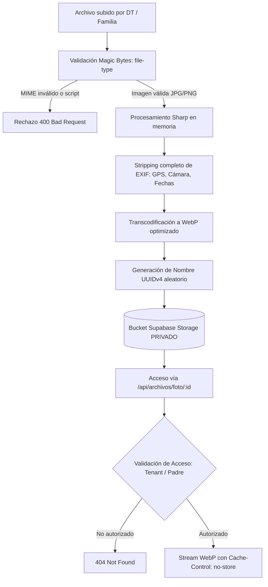

# Seguridad, Privacidad y Matriz de Permisos

La protección de la información en Fútbol Career Mode es un requisito crítico y no negociable: la plataforma almacena **datos biométricos, médicos, de contacto y fotografías de menores de edad**.

Este documento detalla la arquitectura de seguridad, la matriz de control de acceso basada en roles (RBAC), el aislamiento multi-tenant, la tubería de sanitización de imágenes y el subsistema de auditoría inmutable.

---

## 1. Matriz de Control de Acceso (Rol × Recurso)

La plataforma opera bajo 4 roles principales (`SUPER_ADMIN`, `ESCUELA_ADMIN`, `DT`, `JUGADOR`).

| Recurso / Dominio | `SUPER_ADMIN` | `ESCUELA_ADMIN` | `DT` | `JUGADOR` (Familia) |
|---|:---:|:---:|:---:|:---:|
| **Escuelas y Academias** | Crear, listar, suspender | Editar su propia escuela | Solo lectura institucional | Solo lectura institucional |
| **Personal (DTs y Staff)** | Sin acceso ambiental (solo soporte) | Crear, editar, baja, reset pass | Ver colegas asignados | Ver DTs de su categoría |
| **Alumnos y Ficha Médica** | Sin acceso ambiental (solo soporte) | Alta, baja lógica, editar, EPS/alergias | Lectura médica y deportiva | Edición limitada de su hijo |
| **Bloqueo de Acceso (Mora)**| Solo soporte auditado | Bloquear / desbloquear | Visualizar estado | Solo lectura (pantalla bloqueo) |
| **Evaluaciones Físico-Técnicas**| Solo lectura de fórmulas | Ver historial de academia | Evaluar, importar, fijar metas | Ver carta y progreso propio |
| **Eventos y Asistencia** | Sin acceso | Crear, suspender, exportar | Crear, pasar lista, marcador | Ver agenda, confirmar presencia |
| **Finanzas (Aranceles/Cuotas)**| Sin acceso | Crear planes, liquidar, conciliar | Sin acceso financiero | Reportar pago, ver recibos |
| **Mensajería y Circulares** | Sin acceso | Publicar anuncios, hilos privados | Responder hilos de alumnos | Conversar con DT / escuela |
| **Fotos Oficiales de Menores** | Solo soporte *(QA-001 audit)* | Cargar foto oficial alumno | Cargar foto oficial alumno | Cargar foto de su hijo |
| **Avatares y Cosméticos** | Crear fondos globales | Ver catálogo | Ver catálogo | Generar DiceBear, equipar fondo |
| **Parámetros del Motor** | Editar percentiles y fórmulas | Override local por escuela | Solo lectura | Sin acceso |
| **Sesiones de Soporte** | Iniciar, escalar, finalizar | Notificado de auditoría | Sin acceso | Sin acceso |
| **Logs de Auditoría** | Ver logs de plataforma | Ver logs de su escuela | Sin acceso | Sin acceso |

---

## 2. Aislamiento Multi-Tenant (Barrera 2)

El sistema utiliza una arquitectura de base de datos compartida (Shared Database, Shared Schema) donde cada entidad de negocio está vinculada a una `escuelaId`.

### 2.1 Principios de Aislamiento
1. **El Proxy NO es la seguridad**: `src/proxy.ts` (Barrera 1) solo orienta la experiencia de usuario y previene navegación accidental. La seguridad real y obligatoria reside en la capa de servicios (`src/services/`) y repositorios (`src/repositories/`).
2. **Cruce de Tenant = 404 (Not Found)**: Cuando un usuario intenta acceder a un recurso cuyo `escuelaId` no coincide con su sesión (`assertTenant`), el sistema lanza `TenantMismatchError`. La capa de Server Actions y Route Handlers traduce esto en un **404 Not Found**, nunca en un 403 Forbidden. De esta forma, un atacante o usuario curioso no puede verificar la existencia de IDs ajenos mediante enumeración.
3. **Restricción de `SUPER_ADMIN` (Regla M2)**: El Super Administrador **no posee acceso ambiental omnisciente**. No puede ver la lista de alumnos ni las finanzas de una escuela directamente. Para intervenir en una academia, debe abrir una **Sesión de Soporte** (`SesionSoporte`) con motivo explícito registrado en `AuditLog`. Esta sesión nace en modo **Solo Lectura**; si necesita realizar cambios en la base de datos, debe elevarla explícitamente a modo **Escritura** mediante una acción secundaria auditada (`assertSoportePuedeEscribir`).
4. **Test Guardián de Repositorios**: El suite `tests/unit/aislamiento-tenant.test.ts` analiza estáticamente las queries de Prisma. Si un repositorio ejecuta una consulta sobre un modelo con `escuelaId` sin incluir el filtro de escuela, el test falla de forma automática, a menos que la línea esté explícitamente documentada con `// tenant-global:` y su justificación técnica (ej. crons globales o búsquedas por clave única).

---

## 3. Tubería de Protección de Fotos de Menores (Habeas Data)

El almacenamiento y distribución de imágenes de menores de edad cumple estrictamente con el marco legal de protección de datos personales (Ley 1581 de 2012 / GDPR):

### 3.1 Puntos Críticos de la Tubería:
1. **Prohibición de `public/`**: Ninguna foto de un menor se almacena ni se sirve jamás desde la carpeta pública del servidor web.
2. **Inspección de Magic Bytes**: Se analiza la firma binaria real del archivo (`file-type`), impidiendo que ejecutables maliciosos o scripts se camuflen bajo extensiones `.jpg` o `.png`.
3. **Eliminación Total de Metadatos EXIF**: La biblioteca `sharp` purga coordenadas satelitales GPS, número de serie de cámara, fecha y hora de captura, evitando la geolocalización o rastreo de los menores.
4. **Nombres UUID Criptográficos**: Se descarta el nombre de archivo original y se reemplaza por un UUIDv4 indescifrable en el almacenamiento privado.
5. **Encabezado `Cache-Control: no-store`**: El endpoint de entrega prohíbe que navegadores, proxies o CDNs almacenen copias en caché del rostro del menor.
6. **Alternativa Segura (Avatares DiceBear)**: Para familias o escuelas que elijan no subir fotografías reales, la plataforma genera avatares vectoriales SVG en proceso local (sin peticiones a APIs externas de terceros).

---

## 4. Sanitización de Texto Libre (`textoSeguro`)

En cumplimiento de la estrategia de defensa en profundidad, todos los campos de entrada de texto libre (nombres, observaciones de DT, notas médicas, motivos de egreso, circulares) se validan en el borde con el validador Zod personalizado `textoSeguro()` (`src/lib/validators/sanitizar.ts`):
- Recorta espacios en blanco en extremos.
- Limita longitud según el contexto para prevenir denegación de servicio por memoria.
- Rechaza etiquetas HTML (`<script>`, `<iframe>`, `
`), esquemas `javascript:` y controladores de eventos inline (`onload=`, `onclick=`).

---

## 5. Auditoría Inmutable (`AuditLog`)

Las acciones de alto impacto o sensibles para la privacidad quedan asentadas de forma indeleble en la tabla `AuditLog`.

### 5.1 Estructura del Registro de Auditoría
- `id`: Identificador único (UUID).
- `escuelaId`: Academia involucrada (o `null` para eventos globales de plataforma).
- `usuarioId`: Operador responsable de la acción.
- `accion`: Verbo en mayúsculas (`ESCUELA_CREADA`, `JUGADOR_ELIMINADO`, `ACCESO_BLOQUEADO`, `PAGO_APROBADO`, `SOPORTE_INICIADO`, etc.).
- `recurso`: Entidad afectada (`Jugador`, `Pago`, `Membresia`, `SesionSoporte`).
- `recursoId`: Clave primaria del registro modificado.
- `detalles`: Objeto JSON con el estado previo, nuevo estado y justificación obligatoria.
- `createdAt`: Marca temporal inmutable en UTC.

### 5.2 Eventos Obligatoriamente Auditados
1. Apertura, elevación a escritura y cierre de sesiones de soporte técnico por parte de administradores globales.
2. Eliminación (baja lógica) o reactivación de fichas de alumnos.
3. Bloqueo o restitución del acceso al portal para deportistas o familias.
4. Generación de credenciales temporales o restablecimiento forzado de contraseñas.
5. Aprobación, rechazo y anulación de pagos o transferencias bancarias.
6. Importación masiva de deportistas o resultados de evaluaciones físico-técnicas.
