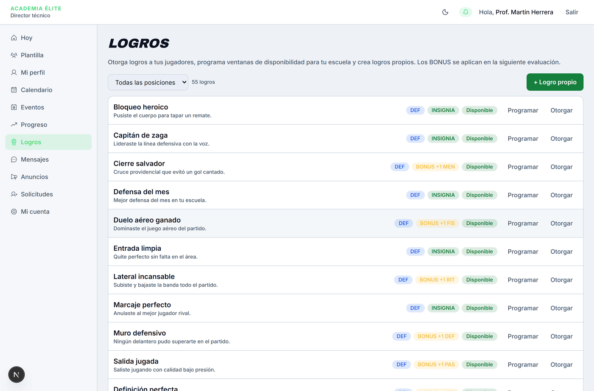
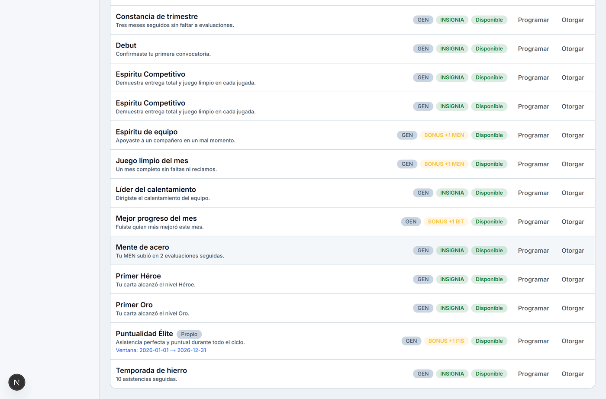
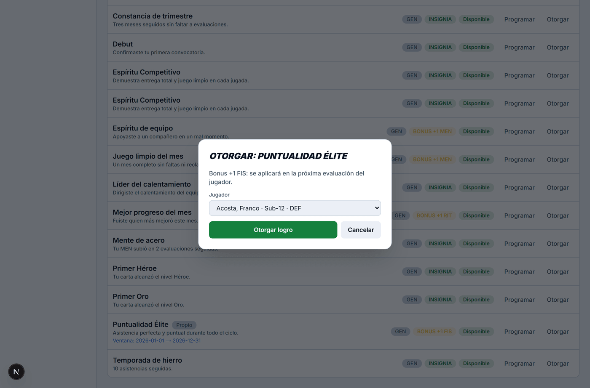

# Logros

> Verificado en la versión 0.1.0 (`6882787`) el 2026-10-19 por Agente de Manuales (Antigravity).

**Para qué sirve:** Permite al Director Técnico (DT) motivar a sus alumnos concediéndoles reconocimientos honoríficos (insignias) o mejoras de rendimiento (bonus que impactan la siguiente evaluación física/técnica), programar ventanas de tiempo en las que un logro está vigente en su escuela y dar de alta logros personalizados exclusivos de su academia.

**Quién lo usa y dónde está:** Entrenador (DT) · Menú lateral → **Logros**.

**Antes de empezar:** Para otorgar logros, el DT debe tener asignadas categorías activas con jugadores matriculados en su **Plantilla**. Los logros que exigen una posición táctica específica (portero, defensa, medio o delantero) solo pueden otorgarse a jugadores que compartan dicha demarcación.

---

## Mapa de la pantalla

*Figura 1: Pantalla principal de logros del DT con catálogo, etiquetas de posición, tipo de premio, estado de disponibilidad y botones de programación y entrega.*

*Figura 2: Logro propio de escuela con distintivo "Propio", ventana de disponibilidad configurada y estado "Disponible".*

*Figura 3: Cuadro de otorgamiento con filtrado automático de alumnos elegibles por posición táctica.*

---

## Controles

| N.º | Control (nombre exacto en pantalla) | Qué hace | Reglas y límites | Si se equivoca (mensaje literal) | Verificado |
|---|---|---|---|---|:---:|
| 1 | **Filtrar por posición** (lista desplegable) | Acota el catálogo a los logros válidos para una demarcación táctica o generales. | Opciones: `Todas las posiciones`, `Generales`, `POR`, `DEF`, `MED`, `DEL`. | N/A | Sí |
| 2 | **Contador de logros** (texto) | Informa la cantidad de logros activos visibles según el filtro seleccionado. | Muestra la cuenta exacta (p. ej. *"53 logros"*). | N/A | Sí |
| 3 | **+ Logro propio** (botón) | Abre un cuadro para crear un logro exclusivo de la escuela del DT. | Botón primario en la esquina superior derecha. | N/A | Sí |
| 4 | **Código (único)** (campo, en el formulario de alta) | Clave única del logro en mayúsculas (p. ej. `PUNTUALIDAD_ELITE`). | Obligatorio. De 4 a 60 caracteres (A-Z, 0-9 y `_`). | Si el formato no coincide: *"Código inválido (A-Z, 0-9 y _)."* Si ya existe: *"Ya existe un logro con ese código."* | Sí |
| 5 | **Posición** (lista desplegable, en el formulario de alta) | Define a qué posiciones aplica el logro propio. | Opciones: `General (todas)`, `POR`, `DEF`, `MED`, `DEL`. | N/A | Sí |
| 6 | **Nombre** (campo, en el formulario de alta) | Título visible del reconocimiento (p. ej. *"Puntualidad Élite"*). | Obligatorio. Texto sin etiquetas ni código, de 3 a 80 caracteres. | Si está vacío: *"Nombre requerido."* | Sí |
| 7 | **Descripción** (campo de texto largo, en el formulario de alta) | Fundamento del reconocimiento o criterio que el alumno debe demostrar. | Obligatorio. Texto sin etiquetas ni código, de 5 a 200 caracteres. | Si está vacío: *"Descripción requerida."* | Sí |
| 8 | **Tipo** (lista desplegable, en el formulario de alta) | Beneficio: `Insignia` (honorífico) o `Bonus` (suma a carta en evaluación). | Opciones: `Insignia`, `Bonus`. | N/A | Sí |
| 9 | **Stat (BONUS)** (lista desplegable, en el formulario de alta) | Estadística beneficiada por el bonus. | Opciones: `—`, `RIT`, `TIR`, `PAS`, `REG`, `DEF`, `FIS`, `MEN`. Obligatorio si el tipo es Bonus. | Si tipo es Bonus y se omite: *"Un logro BONUS necesita stat y valor."* | Sí |
| 10 | **Valor (BONUS)** (campo, en el formulario de alta) | Magnitud del incremento en la evaluación. | Entero de 1 a 3 puntos. Obligatorio si el tipo es Bonus. | El navegador solo acepta números enteros entre 1 y 3. Si falta: *"Un logro BONUS necesita stat y valor."* | Sí |
| 11 | **Repetible (se puede ganar varias veces)** (casilla, en el formulario de alta) | Permite otorgar el logro más de una vez al mismo jugador a lo largo del tiempo. | Casilla que se marca o se desmarca. | N/A | Sí |
| 12 | **Crear logro** (botón, en el formulario de alta) | Guarda el logro asignado a la escuela del DT. | Botón de envío. Muestra *"Creando…"*. | Mensaje de validación visible en un aviso rojo. | Sí |
| 13 | **Cancelar** (botón, en el formulario de alta) | Cierra el cuadro de alta descartando cambios. | Botón secundario. | N/A | Sí |
| 14 | **Programar** (botón, en cada logro de la lista) | Abre el cuadro de configuración de vigencia y disponibilidad para la escuela. | Disponible en todas las filas de logros activos. | N/A | Sí |
| 15 | **Disponible para mi escuela** (casilla, en Programar) | Activa o desactiva la posibilidad de conceder este logro en la academia. | Por defecto marcado. Si se desmarca, el logro pasa a *"No disponible"*. | N/A | Sí |
| 16 | **Desde (opcional)** (selector de fecha, en Programar) | Fecha a partir de la cual el logro entra en vigencia. | Formato calendario de día (`AAAA-MM-DD`). | N/A | Sí |
| 17 | **Hasta (opcional)** (selector de fecha, en Programar) | Fecha límite tras la cual expira la disponibilidad del logro. | Formato calendario de día (`AAAA-MM-DD`). Debe ser igual o posterior a la fecha inicial. | Si Hasta es anterior a Desde: *"La fecha final debe ser posterior a la inicial."* | Sí |
| 18 | **Guardar** (botón, en Programar) | Guarda la ventana de disponibilidad de la escuela. | Muestra *"Guardando…"*. | Mensaje de error si la regla de fechas se rompe. | Sí |
| 19 | **Cancelar** (botón, en Programar) | Cierra el cuadro de programación sin guardar. | Botón secundario. | N/A | Sí |
| 20 | **Otorgar** (botón, en cada logro de la lista) | Abre un cuadro para premiar a un alumno con el logro seleccionado. | **Solo habilitado si el logro está "Disponible"**. Si está inactivo o fuera de ventana, el botón aparece deshabilitado. | N/A | Sí |
| 21 | **Jugador** (lista desplegable, en Otorgar) | Desplegable de selección con los alumnos elegibles de las categorías del DT. | Filtra automáticamente según la posición táctica del logro (p. ej. si el logro es de arquero, solo lista porteros). Muestra Apellido, Nombre, Categoría y Posición. | Si no hay jugadores de esa posición en las categorías del DT: *"No tienes jugadores activos de la posición X en tus categorías."* | Sí |
| 22 | **Otorgar logro** (botón, en Otorgar) | Registra el logro en el expediente del jugador y notifica a su familia. | Botón de envío. Mientras procesa cambia a *"Otorgando…"*. | Si el jugador ya lo tiene y no es repetible: *"El jugador ya tiene ese logro."* Si el jugador no está activo: *"Solo se otorgan logros a jugadores activos."* | Sí |
| 23 | **Cancelar** (botón, en Otorgar) | Cierra el cuadro de entrega sin conceder el logro. | Botón secundario. | N/A | Sí |

---

## Cómo se hace (tareas completas)

### Tarea 1: Crear un logro propio exclusivo para la escuela

1. Inicia sesión como **Entrenador** y pulsa en **Logros** en el menú lateral.
2. Pulsa en el botón verde **+ Logro propio** en la esquina superior derecha.
3. En **Código (único)**, escribe una clave descriptiva en mayúsculas (p. ej. `PUNTUALIDAD_ELITE`).
4. Selecciona la **Posición** a la que aplicará (`General (todas)` o una posición específica).
5. Ingresa el **Nombre** (p. ej. `Puntualidad Élite`) y su **Descripción** (p. ej. `Asistencia perfecta y puntual durante todo el ciclo.`).
6. Si es un incentivo de rendimiento, selecciona **Tipo**: `Bonus`, el **Stat (BONUS)** (p. ej. `FIS`) y el **Valor (BONUS)** (p. ej. `1`). Si es meramente honorífico, selecciona `Insignia`.
7. Pulsa en **Crear logro**.
8. **Resultado:** El logro se agrega a tu catálogo con la insignia **Propio** y queda listo para ser programado u otorgado.

---

### Tarea 2: Programar una ventana de vigencia temporal para un logro

1. En la lista de logros, localiza el ítem que deseas calendarizar.
2. Pulsa en el botón **Programar** situado a la derecha de la fila.
3. Asegúrate de que la casilla **Disponible para mi escuela** esté marcada.
4. En **Desde (opcional)**, selecciona el día en que iniciará la campaña (p. ej. `2026-01-01`).
5. En **Hasta (opcional)**, selecciona el día de finalización (p. ej. `2026-12-31`).
6. Pulsa en **Guardar**.
7. **Resultado:** El cuadro se cierra y en la tarjeta del logro se visualiza la leyenda: `Ventana: 2026-01-01 → 2026-12-31` junto a la etiqueta verde **Disponible**. Fuera de esas fechas, el sistema bloqueará automáticamente el botón de otorgar.

---

### Tarea 3: Otorgar un logro a un alumno

1. En la lista de logros, ubica el logro que deseas entregar y comprueba que tenga la etiqueta verde **Disponible**.
2. Pulsa en el botón **Otorgar**.
3. En el desplegable **Jugador**, selecciona al alumno destinatario de tu categoría.
4. Lee el recordatorio en pantalla:
   - Si es **Insignia**: se sumará a la vitrina de medallas del jugador.
   - Si es **Bonus**: se aplicará en la próxima evaluación que le realices al jugador.
5. Pulsa en **Otorgar logro**.
6. **Resultado:** El cuadro se cierra, la entrega queda registrada con auditoría en el sistema y se envía una notificación automática al portal de la familia del jugador.

---

## Qué ve la otra parte

- **Familia y Jugador:**
  - Reciben una notificación en su panel: *"¡Nuevo logro: <Nombre>!"*.
  - En su sección de **Logros**, si fue una **Insignia**, el candado se desbloquea y se muestra la medalla dorada con su descripción en la vitrina.
  - Si fue un **Bonus**, aparece listado en la sección **Bonus de logros (anti-inflación)** con la etiqueta dorada **Pendiente**, indicando cuántos puntos (+1 a +3) se sumarán en la siguiente evaluación del DT.
- **Súper Admin:** Los logros propios creados por el DT quedan aislados en la escuela correspondiente; el Súper Admin puede auditarlos pero no interfieren con el catálogo global de las demás academias.

---

## Errores y situaciones frecuentes

- **"El jugador ya tiene ese logro.":** Ocurre si intentas otorgar un logro que no está configurado como `Repetible` a un alumno que ya lo consiguió anteriormente. Si el mérito debe poder ganarse periódicamente (p. ej. semanal o mensualmente), el logro debe haberse creado con la opción *Repetible* marcada.
- **"La fecha final debe ser posterior a la inicial.":** Ocurre al programar una ventana si la fecha *Hasta* es anterior a la fecha *Desde*. Debe corregirse el calendario para que el rango sea cronológico.
- **Botón "Otorgar" deshabilitado (gris):** Significa que el logro tiene la etiqueta roja **No disponible**. Esto sucede si la escuela desmarcó la casilla *"Disponible para mi escuela"* o si la fecha actual está fuera de la ventana programada (*Desde / Hasta*).
- **"No tienes jugadores activos de la posición X en tus categorías.":** Aparece dentro del cuadro de otorgar cuando un logro está configurado exclusivamente para una demarcación táctica (p. ej. `POR`) y el DT no tiene ningún arquero matriculado en sus categorías.

---

## Notas internas

> Esta sección no se publica en el manual del usuario.

### Comportamientos conocidos

1. **Reinicio de formulario modal en React 19:** Al igual que en el panel de administración, si el formulario de alta de logro propio es rechazado por validación del servidor, los campos no controlados se vacían en el DOM.
2. **Dependencia de posición estricta en el modal:** El selector de jugadores en el modal de entrega excluye de forma silenciosa a los jugadores que no tienen la posición táctica exacta del logro, lo cual es correcto según las reglas del motor pero puede desconcertar al DT si no recuerda la demarcación del alumno.

### Referencias técnicas (movidas desde la capa pública)

- Ruta de la pantalla: `/dt/logros`. Plantilla del DT: `/dt/plantilla`. Vista de la familia: `/jugador/logros`.
- Tipos de elemento de cada control de la tabla: Filtrar por posición, Posición, Tipo, Stat (BONUS), Jugador y Cantidad de logros son `select`/texto; Código, Nombre y Valor son `input`; Descripción es `textarea`; Repetible y Disponible para mi escuela son `checkbox`; Desde y Hasta son `input type="date"`.
- Valor (BONUS): HTML5 `min="1" max="3"`.
- Los logros propios se guardan con `escuelaId` de la escuela del DT (aislamiento por tenant); Nombre y Descripción pasan por `textoSeguro()`.
- Cuenta demo usada para verificar: `elite-dt@demo.app`.

---

## Registro de verificación

- **Fecha:** 2026-10-19
- **Versión:** `0.1.0` (commit `6882787`)
- **Controles totales:** 23
- **Controles probados:** 23 (100% verificado en ejecución real)
- **Verificador:** Agente de Manuales (Antigravity) mediante Playwright Chromium automatizado contra base de datos demo.
