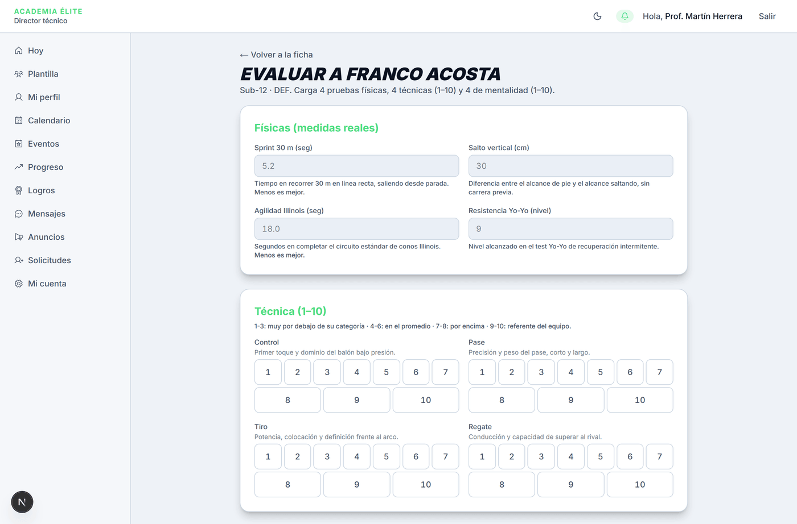
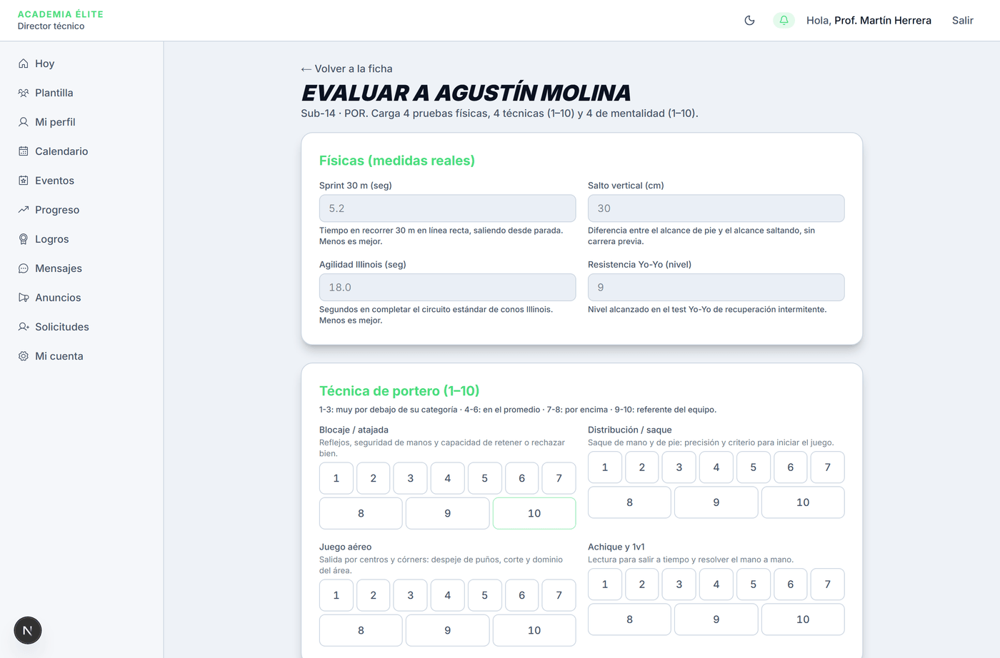
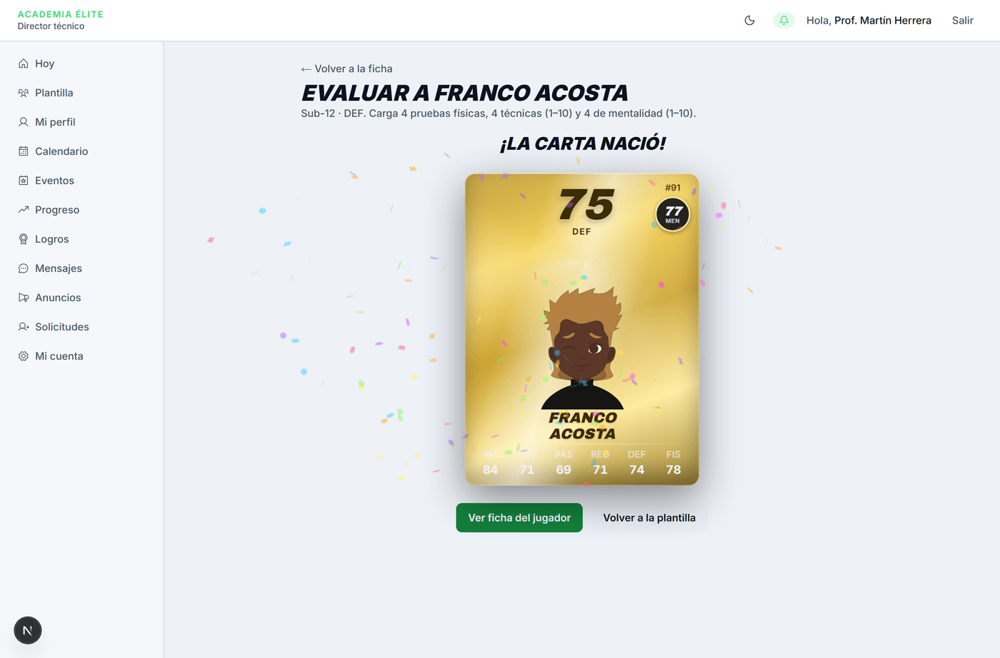
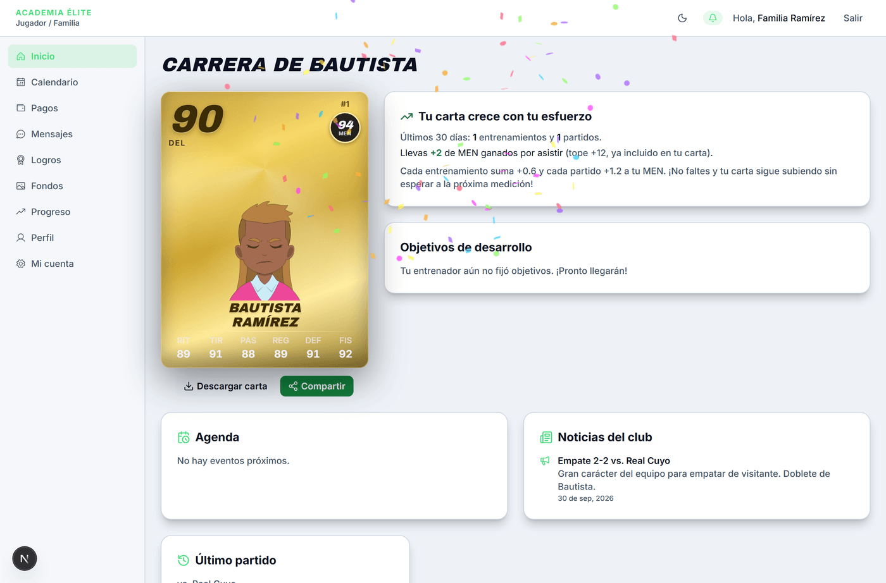
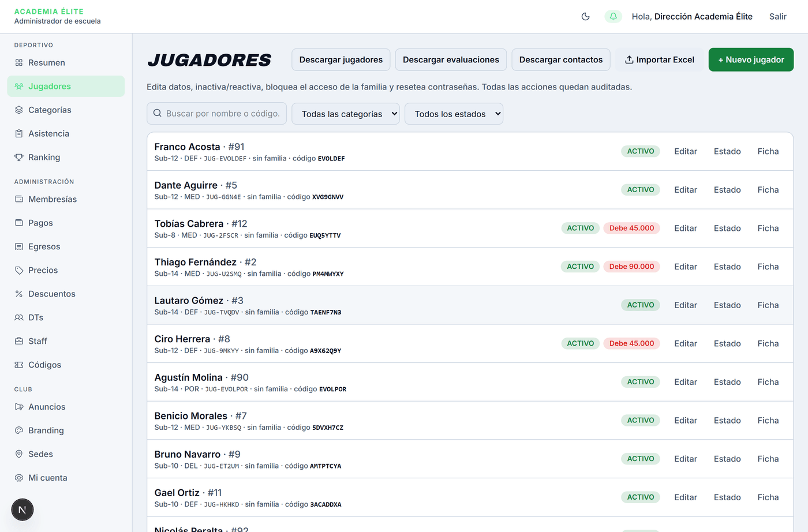

# Mediciones y evaluación

> Verificado en la versión 0.1.0 (`6f9ea7e`) el 2026-10-19 por Agente de Manuales (Antigravity).

**Para qué sirve:** Permite al entrenador registrar los resultados de los tests físicos y valorar las capacidades técnicas y de mentalidad de un jugador para calcular su media global (OVR), determinar el nivel de su carta (Bronce, Plata, Oro o Héroe) y actualizar sus estadísticas oficiales en la plataforma.

**Quién lo usa y dónde está:** Entrenador (DT) · Menú → **Plantilla** → elige al jugador → **Ficha del jugador** → botón **Evaluar ahora**.

**Antes de empezar:** El jugador debe estar dado de alta en la escuela, contar con una categoría asignada (p. ej. Sub-12, Sub-14) y una posición definida (jugador de campo o portero/arquero), ya que la posición determina qué pruebas técnicas se evalúan.

---

## Mapa de la pantalla

*Figura 1: Vista general del formulario de evaluación para un jugador de campo.*

*Figura 2: Adaptación automática de las pruebas técnicas cuando el jugador tiene la posición POR (Portero).*

---

## Controles

| N.º | Control (nombre exacto en pantalla) | Qué hace | Reglas y límites | Si se equivoca (mensaje literal) | Verificado |
|---|---|---|---|---|:---:|
| 1 | **← Volver a la ficha** | Cancela la carga y regresa a la ficha del jugador sin guardar cambios. | Lleva de vuelta a la ficha del jugador. | N/A (no altera datos). | Sí |
| 2 | **Sprint 30 m (seg)** | Registra el tiempo en segundos al recorrer 30 m en línea recta desde parada. | Número decimal positivo, con hasta dos decimales. Menor tiempo equivale a mejor rendimiento. | Si se deja vacío: *"Completa este campo"*. Si es negativo o cero: *"Debe ser un número positivo."* | Sí |
| 3 | **Salto vertical (cm)** | Registra la diferencia en centímetros entre alcance de pie y saltando sin carrera. | Número decimal positivo, con hasta dos decimales. | Si se deja vacío: *"Completa este campo"*. Si es negativo o cero: *"Debe ser un número positivo."* | Sí |
| 4 | **Agilidad Illinois (seg)** | Registra el tiempo en segundos para completar el circuito estándar de conos. | Número decimal positivo, con hasta dos decimales. Menor tiempo equivale a mejor rendimiento. | Si se deja vacío: *"Completa este campo"*. Si es negativo o cero: *"Debe ser un número positivo."* | Sí |
| 5 | **Resistencia Yo-Yo (nivel)** | Registra el nivel alcanzado en el test de recuperación intermitente Yo-Yo. | Número decimal positivo, con hasta dos decimales. Mayor nivel equivale a mejor rendimiento. | Si se deja vacío: *"Completa este campo"*. Si es negativo o cero: *"Debe ser un número positivo."* | Sí |
| 6 | **Técnica (1–10)** *(Jugador de campo)*: • **Control** • **Pase** • **Tiro** • **Regate** | Botones de selección obligatoria del 1 al 10 para cada faceta técnica de campo: - *Control*: Primer toque y dominio bajo presión. - *Pase*: Precisión y peso corto/largo. - *Tiro*: Potencia, colocación y definición. - *Regate*: Conducción y desborde 1v1. | Rúbrica estándar: 1–3 muy por debajo; 4–6 en el promedio; 7–8 por encima; 9–10 referente del equipo. No hay valor preseleccionado. | Si falta alguna nota, el botón de guardado no se activa y se muestra: *"Elige las 8 notas (técnicas y mentalidad) para poder guardar."* | Sí |
| 7 | **Técnica de portero (1–10)** *(Portero)*: • **Blocaje / atajada** • **Distribución / saque** • **Juego aéreo** • **Achique y 1v1** | Botones de selección obligatoria del 1 al 10 adaptados para el arquero: - *Blocaje*: Reflejos y seguridad de manos. - *Distribución*: Saque con mano y pie. - *Juego aéreo*: Salida en centros y córners. - *Achique*: Lectura de mano a mano. | Rúbrica estándar (1–10). Se activa automáticamente cuando la posición del jugador es `POR`. | Si falta alguna nota técnica, el botón de guardado permanece inactivo. | Sí |
| 8 | **Mentalidad (1–10)**: • **Actitud** • **Concentración** • **Trabajo en equipo** • **Resiliencia** | Botones de selección obligatoria del 1 al 10 para evaluar aspectos conductuales y competitivos: - *Actitud*: Compromiso general y ante la adversidad. - *Concentración*: Sostén de la atención en el trabajo. - *Trabajo en equipo*: Comunicación y juego asociativo. - *Resiliencia*: Capacidad de superar errores. | Rúbrica estándar (1–10). Obligatorio para todas las posiciones. | Si falta alguna nota de mentalidad, el botón de guardado permanece inactivo. | Sí |
| 9 | **Observaciones para la familia (las verá el acudiente)** | Campo de texto libre para observaciones pedagógicas o formativas visibles para la familia en su panel. | Opcional. Longitud máxima 2000 caracteres. No admite código ni etiquetas. | Si supera 2000 caracteres: *"Máximo 2000 caracteres."* | Sí |
| 10 | **Guardar evaluación y generar carta** | Botón principal de envío que calcula las estadísticas a partir de las medidas y crea la carta. | Permanece deshabilitado hasta que se hayan seleccionado las 8 notas (4 técnicas + 4 mentalidad). Mientras procesa muestra *"Calculando carta…"*. | Si hay error de red o servidor: mensaje de error visible en un aviso rojo. | Sí |
| 11 | **Ver ficha del jugador** | Enlace disponible en la pantalla de éxito *"¡La carta nació!"*. | Lleva a la ficha del jugador. | N/A | Sí |
| 12 | **Volver a la plantilla** | Enlace secundario en la pantalla de éxito. | Lleva a la pantalla de inicio del entrenador (**Hoy**), no al listado de la plantilla. | N/A | Sí |

---

## Cómo se hace (tareas completas)

### Tarea: Evaluar a un jugador y generar su carta deportiva

1. En el menú lateral izquierdo del panel de Entrenador, haz clic en **Plantilla**.
2. Localiza al jugador que deseas evaluar en el listado y haz clic sobre su tarjeta o nombre para ingresar a su ficha.
3. En la ficha del jugador, haz clic en el botón verde **Evaluar ahora** ubicado en el encabezado.
4. En la sección **Físicas (medidas reales)**, ingresa los resultados cronometrados y medidos:
   - **Sprint 30 m (seg)** (p. ej. `4.92`).
   - **Salto vertical (cm)** (p. ej. `32.5`).
   - **Agilidad Illinois (seg)** (p. ej. `17.8`).
   - **Resistencia Yo-Yo (nivel)** (p. ej. `10.5`).
5. En la sección **Técnica (1–10)** (o **Técnica de portero** si es arquero), presiona un número del 1 al 10 para cada una de las 4 cualidades técnicas. El número seleccionado quedará resaltado con el color de la escuela.
6. En la sección **Mentalidad (1–10)**, presiona un número del 1 al 10 para cada una de las 4 dimensiones conductuales.
7. (Opcional) En el recuadro **Observaciones para la familia**, redacta un mensaje de retroalimentación constructiva sobre el desempeño del jugador.
8. Verifica que el aviso *"Elige las 8 notas (técnicas y mentalidad) para poder guardar"* haya desaparecido y que el botón **Guardar evaluación y generar carta** se encuentre activo.
9. Haz clic en **Guardar evaluación y generar carta**.
10. **Resultado:** La pantalla muestra la animación de confeti con el título **¡La carta nació!**, presentando la carta 3D del jugador con su nivel (Bronce, Plata, Oro o Héroe), su media global (OVR), sus 6 atributos calculados (RIT, TIR, PAS, REG, DEF, FIS) y su estadística de mentalidad (MEN).

*Figura 3: Pantalla de resultado instantáneo tras calcular y generar la carta.*

---

## Qué ve la otra parte

### Qué ve la familia
- En cuanto el entrenador guarda la evaluación, la familia ve actualizada inmediatamente la carta principal en su pantalla **Inicio**, mostrando el nuevo OVR, el nivel de carta y los 6 atributos principales.
- Si el entrenador incluyó texto en **Observaciones para la familia**, este aparece visible en el historial del jugador para los acudientes.

*Figura 4: Vista instantánea en el panel de la familia.*

### Qué ve la administración de la escuela
- En el listado **Jugadores** del menú de la escuela, el jugador pasa a mostrar su nuevo OVR y nivel de carta actualizado.
- La evaluación impacta de forma automática la tabla de **Ranking** de la escuela.

*Figura 5: Vista de jugadores en el panel de administración de la escuela.*

---

## Errores y situaciones frecuentes

| Situación | Causa | Qué hacer |
|---|---|---|
| El botón **Guardar evaluación y generar carta** está deshabilitado y no reacciona al clic. | Falta puntuar alguna de las 8 notas obligatorias (4 técnicas y 4 de mentalidad). | Revisa los bloques de Técnica y Mentalidad. Cada uno de los 8 atributos debe tener un botón numérico marcado en color resaltado. |
| El navegador muestra *"Completa este campo"* al intentar guardar. | Alguno de los 4 campos físicos obligatorios quedó vacío. | Diligencia los 4 valores numéricos de las pruebas físicas. |
| El formulario muestra *"Debe ser un número positivo."* | Se introdujo un valor igual a 0 o negativo en alguna medida física. | Registra medidas físicas reales mayores a cero. |
| No aparece la opción de evaluar en la ficha del jugador. | El jugador no tiene categoría o la escuela/usuario no cuenta con permisos activos de entrenador en esa escuela. | Comprueba que el usuario sea entrenador asignado a la escuela y que el jugador esté activo en una categoría. |

---

## Notas internas

> Esta sección no se publica en el manual del usuario.

### Comportamientos conocidos

1. **Sin función de edición ni anulación en interfaz:** Las evaluaciones deportivas son inmutables por diseño (reflejan el momento histórico de la prueba). Existe una función de servicio en backend (`anularEvaluacion`) restringida al Administrador de Escuela para casos excepcionales con motivo auditado, pero **no existe un botón en la interfaz de usuario** para ejecutar dicha anulación. Si un entrenador comete un error al registrar un dato, la solución operativa actual es realizar una nueva evaluación correcta, la cual pasará a ser la evaluación vigente de la carta.
2. **Sin valores por defecto deliberado:** Los botones de nota (1–10) no tienen ningún valor precargado (no arrancan en 5). Esto es una decisión de diseño intencional para evitar evaluaciones sesgadas o automáticas.

### Referencias técnicas (movidas desde la capa pública)

- Ruta del formulario: `/dt/jugadores/[id]/evaluar`. Ruta de la ficha: `/dt/jugadores/[id]`. Listado de plantilla: `/dt/plantilla`. Estas dos últimas no tienen ficha propia de manual; por eso no figuran en `rutas` y la cobertura las reporta "sin documentar".
- Campos físicos (Sprint, Salto, Agilidad, Yo-Yo): `<input type="number">` con `step="0.01"` y `min="0"`.
- **Observaciones para la familia** pasa por `textoSeguro()` (recorta, máx. 2000 caracteres y rechaza HTML y scripts).
- El error del botón de guardado se pinta con `role="alert"`.
- Enlace **Ver ficha del jugador**: `/dt/jugadores/[id]`. Enlace **Volver a la plantilla**: apunta a `/dt` (Inicio, "Hoy" en el menú), no a `/dt/plantilla`. Posible hallazgo de QA por nombre engañoso del enlace (formato de `POLITICA-QA.md` §6).
- Vistas cruzadas: familia en `/jugador`; escuela en `/escuela/jugadores` y `/escuela/ranking`.
- Los mensajes de error de campos vacíos ("Completa este campo") son los del navegador.

---

## Registro de verificación

- **Fecha:** 2026-10-19
- **Versión evaluada:** 0.1.0 (`6f9ea7e`)
- **Total de controles en pantalla:** 12
- **Controles probados en vivo:** 12 (100 %)
- **Pruebas realizadas:**
  - Carga con datos válidos (camino feliz) para jugador de campo.
  - Validación de adaptación dinámica de etiquetas técnicas para portero (POR).
  - Comprobación de estado deshabilitado con 0 notas y con 7 de 8 notas.
  - Validación de campos requeridos y tipos de datos.
  - Verificación de renderizado y animación de carta nacida (OVR y stats).
  - Verificación cruzada de impacto en el rol Familia (`elite-familia@demo.app`).
  - Verificación cruzada de impacto en el rol Escuela Admin (`elite-admin@demo.app`).
  - Verificación de adaptabilidad responsive en viewport móvil (375 px).
- **Verificador:** Agente de Manuales (Antigravity).
