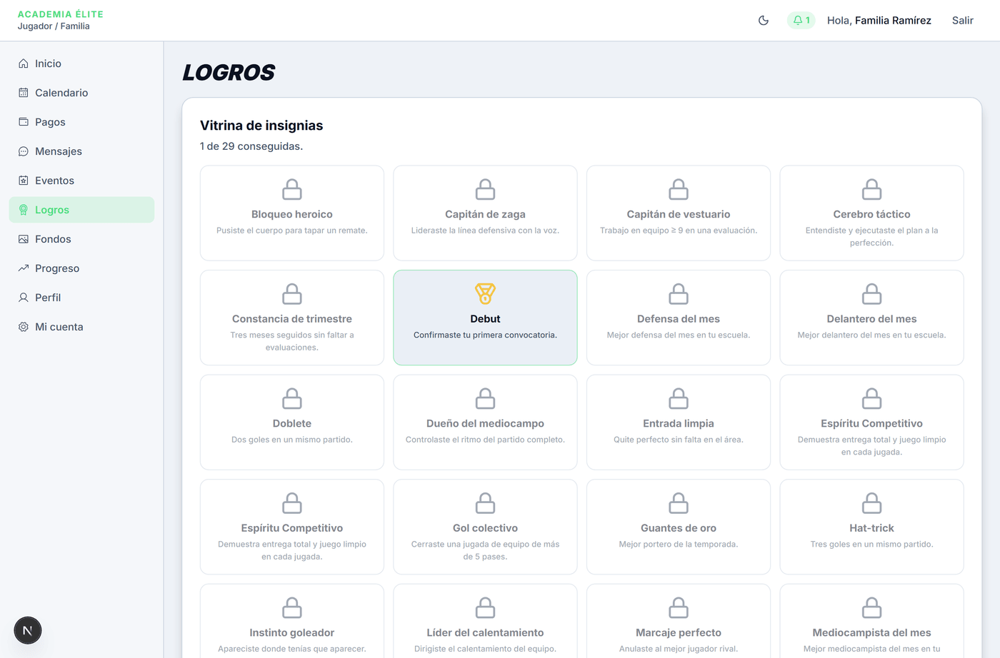
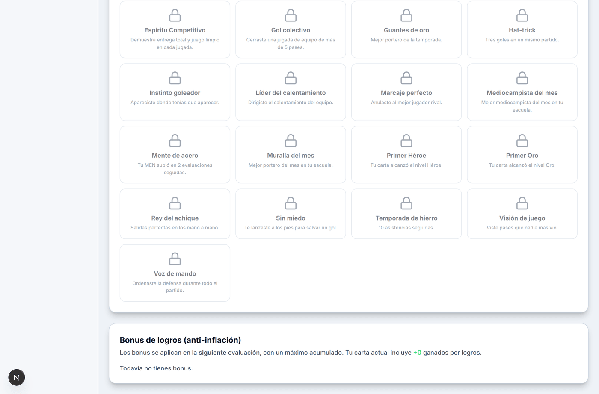

# Logros

> Verificado en la versión 0.1.0 (`6882787`) el 2026-10-19 por Agente de Manuales (Antigravity).

**Para qué sirve:** Es la sala de trofeos y progreso deportivo del jugador y su familia, donde pueden consultar las insignias honoríficas conseguidas (medallas doradas vs. retos bloqueados con candado) y el estado de los bonus de rendimiento acumulados que mejorarán las estadísticas de la carta en la siguiente evaluación.

**Quién lo usa y dónde está:** Familia y Jugador · Menú de navegación → **Logros**.

**Antes de empezar:** La cuenta de usuario debe tener al menos un jugador vinculado con matrícula activa en su escuela. Si aún no hay un jugador asociado, la pantalla informa que está pendiente la vinculación.

---

## Mapa de la pantalla

*Figura 1: Vitrina de insignias conseguidas (con medalla de oro) y pendientes por desbloquear (con candado).*

*Figura 2: Control de bonus por logros con desglose de puntos aplicados a la carta y bonus pendientes de evaluación.*

---

## Controles e Indicadores

| N.º | Control o Elemento (nombre en pantalla) | Qué muestra / Qué hace | Reglas y límites | Si se equivoca o estado límite | Verificado |
|---|---|---|---|---|:---:|
| 1 | **Vitrina de insignias** (recuadro) | Contenedor principal de todos los galardones honoríficos del jugador. | Agrupa todas las insignias de su posición táctica y las de alcance general. | Si no hay jugador vinculado: *"Aún no hay un jugador vinculado a tu cuenta."* | Sí |
| 2 | **Contador de progreso** (texto) | Indica cuántas insignias ha conquistado el alumno sobre el total disponible. | Formato: `X de Y conseguidas.` (p. ej. *"1 de 28 conseguidas."*). | Si no ha ganado ninguna: muestra `0 de Y conseguidas.`. | Sí |
| 3 | **Insignia desbloqueada** (tarjeta) | Reconocimiento conseguido tras haber sido otorgado por el entrenador. | Muestra el icono de medalla de oro, borde resaltado en verde, nombre en negrita y descripción del mérito. | Incluye texto emergente (*tooltip*) al posar el cursor sobre la tarjeta. | Sí |
| 4 | **Insignia bloqueada** (tarjeta) | Reto pendiente que el alumno puede proponerse alcanzar durante los entrenamientos y partidos. | Muestra el icono de candado, aspecto atenuado (50 % de opacidad), nombre de la insignia y descripción del criterio para ganarla. | Ayuda a orientar los objetivos de superación personal del deportista. | Sí |
| 5 | **Bonus de logros (anti-inflación)** (recuadro) | Panel de control de puntos adicionales ganados por mérito deportivo. | Explica la regla de anti-inflación: los bonus no inflan la carta de inmediato, sino que se computan al momento de la siguiente evaluación física del DT. | Detalla con texto resaltado los puntos ya volcados a la carta actual (`Tu carta actual incluye +X ganados por logros.`). | Sí |
| 6 | **Estado de lista de bonus** (lista) | Detalle de cada bonus ganado, especificando el atributo beneficiado y su estado. | Desglosa: Nombre del logro, incremento `(+X STAT)` y etiqueta de estado: `Pendiente` (dorado) o `Aplicado` (verde pitch). | Si aún no tiene bonus: *"Todavía no tienes bonus."*. | Sí |
| 7 | **Distintivo "Pendiente"** (etiqueta dorada) | Indica que el bonus fue otorgado por el DT pero aún no se ha realizado la siguiente evaluación periódica. | El punto (+1 a +3 en RIT, TIR, PAS, REG, DEF, FIS o MEN) entrará en la carta tan pronto el entrenador registre una nueva evaluación del jugador. | N/A | Sí |
| 8 | **Distintivo "Aplicado"** (etiqueta verde) | Certifica que el bonus ya fue absorbido por el motor de cálculo y está sumado a la estadística oficial de la carta activa. | Un bonus consumido ya no vuelve a sumar en futuras evaluaciones, preservando el equilibrio estadístico. | N/A | Sí |

---

## Cómo se hace (tareas completas)

### Tarea 1: Consultar los requisitos para desbloquear una nueva insignia

1. Inicia sesión con la cuenta de **Familia / Jugador** y pulsa en **Logros** en el menú de navegación (o barra inferior en el móvil).
2. En la sección **Vitrina de insignias**, ubica cualquiera de las tarjetas con icono de candado gris.
3. Lee el título y la descripción debajo de la tarjeta (p. ej. *Capitán de vestuario*: *"Trabajo en equipo ≥ 9 en una evaluación"* o *Constancia de trimestre*: *"Tres meses seguidos sin faltar a evaluaciones"*).
4. **Resultado:** El jugador y su familia conocen exactamente qué actitud, rendimiento o asistencia deportiva deben mantener en cancha para que el DT les conceda la medalla.

---

### Tarea 2: Verificar si un bonus otorgado ya impactó en la carta

1. Desde la pantalla de **Logros**, desplázate hacia abajo hasta la tarjeta **Bonus de logros (anti-inflación)**.
2. Revisa la lista de bonus registrados:
   - Si figura con la etiqueta dorada **Pendiente**, el incremento está reservado y se sumará a los puntos de campo en la próxima fecha de evaluación del DT.
   - Si figura con la etiqueta verde **Aplicado**, significa que el DT ya realizó una evaluación posterior a la concesión del logro y el atributo de la carta ya tiene el punto incorporado.
3. Comprueba el texto informativo superior: *"Tu carta actual incluye +X ganados por logros"*.
4. **Resultado:** Transparencia total sobre el origen de las mejoras en el OVR y atributos de la carta EA FC del jugador.

---

## Qué ve la otra parte

- **Entrenador (DT):** Cuando el DT entra a la ficha del jugador desde su **Plantilla**, puede ver qué insignias ya tiene ganadas para no repetir reconocimientos no acumulables y saber cuántos bonus pendientes tiene para su próxima sesión de evaluación.
- **Administrador de Escuela:** En los reportes de evolución y asistencia, la escuela puede constatar el compromiso y motivación del plantel.

---

## Errores y situaciones frecuentes

- **"Aún no hay un jugador vinculado a tu cuenta.":** Aparece si el usuario familiar recién se registra pero la academia todavía no asoció a su hijo mediante el código de invitación o asignación administrativa. Debe contactarse a la escuela para completar la vinculación.
- **"Todavía no tienes bonus.":** Es el estado natural al ingresar por primera vez o antes de que el entrenador entregue el primer reconocimiento de tipo Bonus. Desaparece automáticamente cuando el DT otorga un mérito desde su panel.
- **¿Por qué gané un bonus y mi carta no subió de inmediato?:** Esto responde al diseño del sistema (anti-inflación). A diferencia de un videojuego ficticio, en el fútbol real las mejoras se consolidan con el entrenamiento: el bonus queda **Pendiente** y se aplica como premio acumulado en la siguiente evaluación formal del cuerpo técnico.

---

## Notas internas

> Esta sección no se publica en el manual del usuario.

### Comportamientos conocidos

1. **Ausencia de fecha de obtención en la tarjeta visual:** Las insignias en la vitrina exhiben el icono, nombre y descripción, pero no la fecha exacta en que el entrenador las concedió (disponible solo en el historial de auditoría y notificaciones).
2. **Navegación móvil fluida:** En pantallas pequeñas (375 px), la vitrina se adapta automáticamente a dos columnas sin desbordamiento horizontal y el panel de bonus conserva sus etiquetas de contraste legibles.

### Referencias técnicas (movidas desde la capa pública)

- Rutas: pantalla `/jugador/logros`; evaluación del entrenador `/dt/jugadores/[id]/evaluar`; ficha del jugador para el DT `/dt/jugadores/[id]`.
- Componentes y estilos: iconos `Medal` (insignia conseguida) y `Lock` (bloqueada); borde `border-brand/50`; la insignia bloqueada usa opacidad 50 %.
- Tipos de elemento: la vitrina y el panel de bonus son tarjetas; el contador es texto; el estado de bonus es una lista con badges (dorado para Pendiente, verde pitch para Aplicado).
- Cuenta demo usada para verificar: `elite-familia@demo.app`.

---

## Registro de verificación

- **Fecha:** 2026-10-19
- **Versión:** `0.1.0` (commit `6882787`)
- **Controles totales:** 8
- **Controles probados:** 8 (100% verificado en pantalla real)
- **Verificador:** Agente de Manuales (Antigravity) mediante Playwright Chromium automatizado contra base de datos demo.
