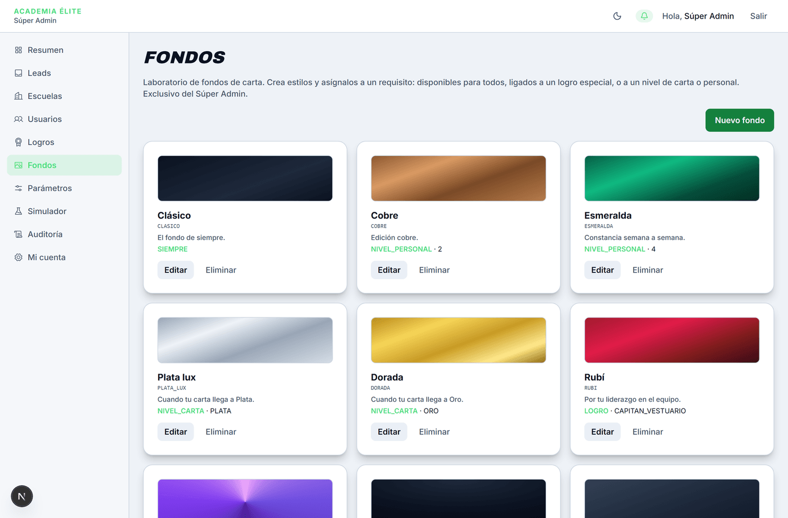
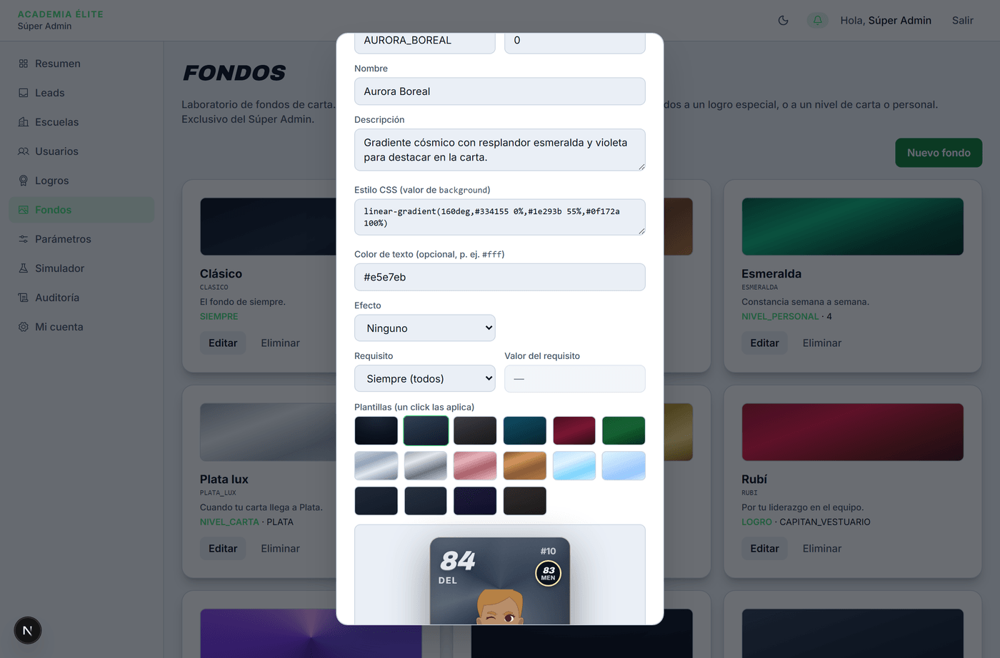
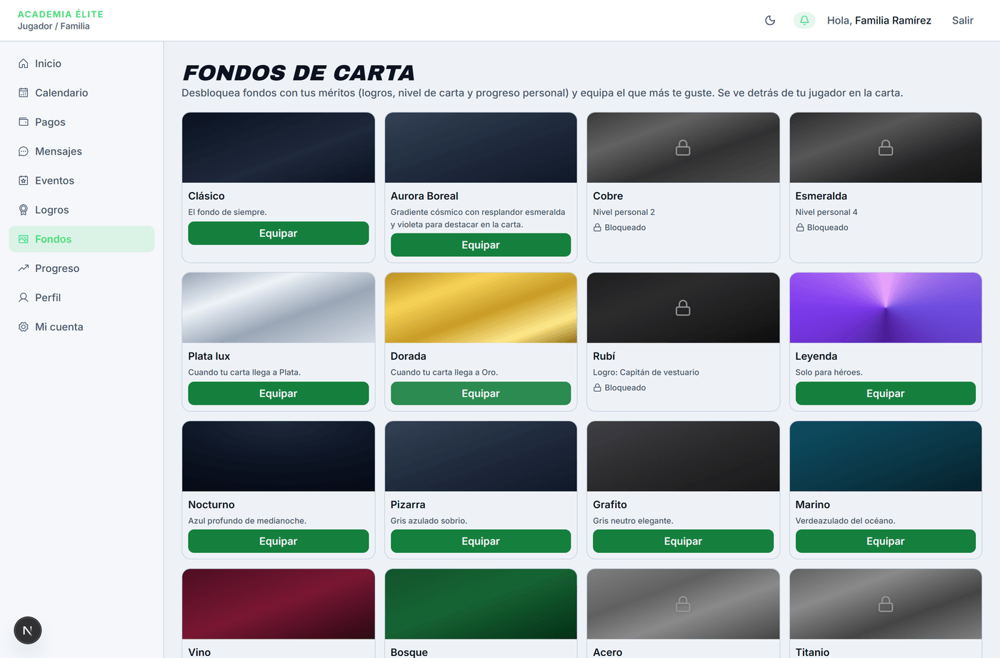
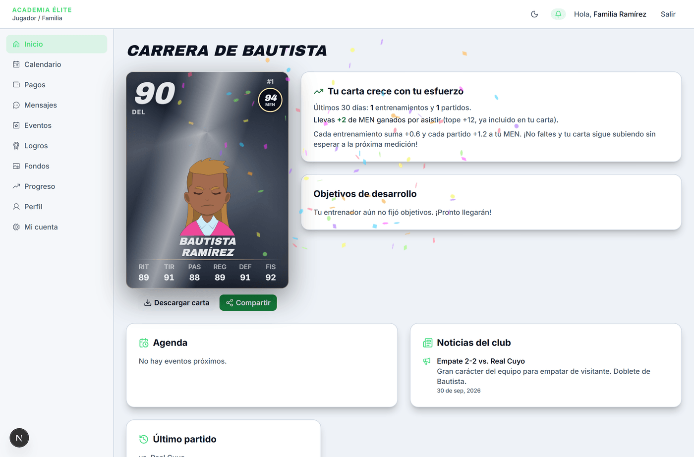

# Fondos

> Verificado en la versión 0.1.0 (`6f9ea7e`) el 2026-10-19 por Agente de Manuales (Antigravity).

**Para qué sirve:** Es el laboratorio global de personalización visual de cartas deportivas donde el Súper Administrador crea, edita, configura efectos dinámicos (metálicos, holográficos, tramas o hielo) y define los requisitos de desbloqueo (logros, niveles o acceso general) para todos los fondos disponibles en la plataforma.

**Quién lo usa y dónde está:** Súper Admin · Menú principal → **Fondos**.

**Antes de empezar:** Para vincular un fondo a un logro específico, dicho logro debe estar creado previamente en el catálogo de logros (Menú → **Logros**). Si el requisito es por nivel de carta o acceso libre, no se requiere ningún paso previo.

---

## Mapa de la pantalla

*Figura 1: Catálogo de fondos registrados con su previsualización, requisitos y acciones.*

*Figura 2: Editor de fondos con paleta de plantillas, configuración de efectos y previsualización de carta 3D en vivo.*

---

## Controles

| N.º | Control (nombre exacto en pantalla) | Qué hace | Reglas y límites | Si se equivoca (mensaje literal) | Verificado |
|---|---|---|---|---|:---:|
| 1 | **Nuevo fondo** | Abre el cuadro de creación para dar de alta un nuevo estilo en el catálogo global. | Botón primario en la esquina superior derecha. | N/A | Sí |
| 2 | **Código (único)** | Identificador único e inalterable del fondo en mayúsculas (p. ej. `AURORA_BOREAL`). | Obligatorio al crear; deshabilitado al editar. Solo letras mayúsculas A-Z, números 0-9 y guión bajo `_`. Longitud entre 3 y 60 caracteres. | Si el formato no coincide: *"Código inválido (A-Z, 0-9 y _)."* Si ya existe: *"Ya existe un fondo con ese código."* | Sí |
| 3 | **Orden** | Define la posición relativa en la que aparecerá el fondo en la galería de los jugadores. | Número entero mayor o igual a 0. Por defecto `0`. Menor número aparece primero. | Si es negativo o decimal: el navegador rechaza el valor (solo acepta números enteros desde 0). | Sí |
| 4 | **Nombre** | Nombre visible del fondo en las galerías de todos los roles (p. ej. *"Aurora Boreal"*). | Obligatorio. Texto sin etiquetas ni código, de entre 3 y 80 caracteres. | Si está vacío o tiene menos de 3 caracteres: *"Nombre requerido."* | Sí |
| 5 | **Descripción** | Explicación del fondo o motivación para el jugador (p. ej. *"Gradiente cósmico..."*). | Obligatorio. Texto sin etiquetas ni código, de entre 5 y 200 caracteres. | Si está vacío o tiene menos de 5 caracteres: *"Descripción requerida."* | Sí |
| 6 | **Estilo CSS (valor de background)** | Código de estilo que define el fondo de la carta (colores y degradados). | Obligatorio. Entre 3 y 2000 caracteres. Admite colores sólidos y degradados lineales o radiales escritos en formato CSS estándar. Exclusivo de Súper Admin. | Si está vacío: *"El estilo CSS es requerido."* | Sí |
| 7 | **Color de texto (opcional, p. ej. `#fff`)** | Define el color de contraste tipográfico para las estadísticas, nombre y OVR en la carta. | Opcional. Código de color CSS o hexadecimal (máx. 40 caracteres). Si se omite, hereda el contraste predeterminado de la carta. | N/A | Sí |
| 8 | **Efecto** | Aplica un acabado o textura sobre el fondo de la carta. | Menú desplegable con 5 opciones: • `Ninguno` • `Metálico` • `Hielo` • `Trama` • `Holográfico` | N/A | Sí |
| 9 | **Tinte** *(solo visible con efecto Metálico)* | Selecciona el tono metálico del resplandor. | Opciones: `oro`, `plata`, `bronce`, `acero`, `cobre`. | N/A | Sí |
| 10 | **Patrón** *(solo visible con efecto Trama)* | Selecciona el patrón repetitivo de la trama. | Opciones: `carbono`, `lineas`, `puntos`, `cuadricula`, `panal`. | Si se envía Trama sin patrón: *"El efecto Trama requiere un patrón."* | Sí |
| 11 | **Intensidad** *(visible cuando efecto ≠ Ninguno)* | Regula la fuerza visual del efecto sobre el estilo base. | Opciones: • `Sutil` (0.3) • `Media` (0.5) • `Intensa` (0.7) | N/A | Sí |
| 12 | **Requisito** | Tipo de mérito exigido al jugador para poder equipar el fondo. | Opciones: • `Siempre (todos)`: Disponible para cualquiera. • `Logro especial`: Requiere desbloquear un logro. • `Nivel de carta`: Requiere alcanzar un nivel de carta. • `Nivel personal`: Requiere alcanzar un nivel de progresión. | Si el valor no coincide con el tipo: *"El requisito necesita un valor válido para su tipo."* | Sí |
| 13 | **Valor del requisito** | Parámetro concreto según el tipo de requisito seleccionado. | • Si es `Siempre`: Inactivo (`—`). • Si es `Logro`: Desplegable de logros del catálogo. • Si es `Nivel de carta`: Desplegable (`BRONCE`, `PLATA`, `ORO`, `HEROE`). • Si es `Nivel personal`: Campo numérico entero (mínimo 1). | Si falta el valor correspondiente: *"El requisito necesita un valor válido para su tipo."* | Sí |
| 14 | **Plantillas (un click las aplica)** | Galería interactiva de 16 estilos preconfigurados con sus gradientes, tintes y efectos listos. | Botones de muestra visual. Al hacer clic, completa automáticamente los campos de Estilo CSS, Color de texto, Efecto y Parámetros. | N/A | Sí |
| 15 | **Previsualización interactiva de carta** | Renderiza una carta de prueba en 3D en tiempo real con el fondo y efecto configurados. | Componente reactivo sin persistencia; permite validar el contraste y legibilidad antes de guardar. | N/A | Sí |
| 16 | **Crear fondo / Guardar cambios** | Guarda el fondo y actualiza el catálogo global. | Botón de envío. Mientras procesa cambia su texto a *"Guardando…"*. Si hay errores, muestra un aviso rojo visible. | Mensaje de error específico según la regla rota. | Sí |
| 17 | **Cancelar** | Cierra el cuadro de creación o edición descartando los cambios no guardados. | Botón secundario. | N/A | Sí |
| 18 | **Editar** *(en tarjeta de catálogo)* | Abre el cuadro precargado con los datos del fondo existente. | Permite modificar todos los atributos excepto el campo `Código`. | N/A | Sí |
| 19 | **Eliminar** *(en tarjeta de catálogo)* | Elimina el fondo del catálogo global tras confirmación nativa del navegador. | Solicita confirmación: *"¿Eliminar el fondo \"<Nombre>\"?"*. Si el fondo está equipado en cartas activas, estas revierten de forma segura al fondo base sin romper la interfaz. | N/A | Sí |

---

## Cómo se hace (tareas completas)

### Tarea 1: Crear y publicar un nuevo fondo de carta

1. Inicia sesión con la cuenta de **Súper Administrador** y entra a **Fondos** desde el menú lateral.
2. Haz clic en el botón verde **Nuevo fondo** en la parte superior derecha.
3. En el campo **Código (único)**, escribe una clave en mayúsculas sin espacios (p. ej. `AURORA_BOREAL`).
4. Ingresa el **Nombre** (p. ej. `Aurora Boreal`) y una **Descripción** explicativa.
5. (Recomendado) En la sección **Plantillas (un click las aplica)**, haz clic sobre una de las muestras visuales para cargar una combinación estética balanceada.
6. Ajusta el **Efecto** si deseas agregar acabado metálico, trama geométrica o resplandor holográfico, seleccionando su **Intensidad** (`Sutil`, `Media` o `Intensa`).
7. En el selector **Requisito**, elige la regla de acceso:
   - Para que todos los jugadores puedan usarlo de inmediato, selecciona `Siempre (todos)`.
   - Para premiar a los mejores jugadores, selecciona `Nivel de carta` y elige `ORO` o `HEROE`.
8. Observa la **Previsualización interactiva de carta** al final del formulario para confirmar que el texto de las estadísticas sea nítido y legible sobre el fondo.
9. Desplaza el formulario hacia abajo y haz clic en **Crear fondo**.
10. **Resultado:** El cuadro se cierra y el nuevo fondo aparece listado de inmediato en la cuadrícula del laboratorio.

---

### Tarea 2: Modificar o eliminar un fondo existente

1. En el catálogo de **Fondos**, localiza la tarjeta del fondo que deseas gestionar.
2. Para editar: haz clic en **Editar**, modifica los valores deseados (el código original permanecerá bloqueado para preservar la integridad de las referencias) y haz clic en **Guardar cambios**.
3. Para eliminar: haz clic en **Eliminar**. Ante el diálogo de confirmación del navegador (*"¿Eliminar el fondo..."*), haz clic en **Aceptar**.
4. **Resultado:** El fondo se elimina del catálogo. Las familias de jugadores que lo tenían equipado dejarán de verlo como opción activa y su carta volverá al fondo predeterminado de su nivel sin pérdida de estadísticas ni fallos visuales.

---

## Qué ve la otra parte

### Qué ve la familia y el jugador
- En el menú del jugador, al ingresar a **Fondos**, el nuevo fondo aparece en la galería:
  - Si cumple el requisito (o se configuró como `Siempre`), se muestra en colores vivos con el botón **Equipar**.
  - Si no cumple el requisito, se muestra atenuado en escala de grises con un ícono de candado (`🔒 Bloqueado`) y el texto explícito del requisito que debe alcanzar (p. ej. *"Cuando tu carta llega a Oro"*).
- Al pulsar **Equipar**, el botón cambia a **Quitar** con el distintivo **✓ Equipado** y la carta principal de la pantalla **Inicio** pasa a mostrar el nuevo fondo inmediatamente.

*Figura 3: Vista de la galería de fondos para la familia con estados desbloqueados y bloqueados.*

*Figura 4: Resultado visible en la carta 3D del jugador con el fondo personalizado equipado.*

---

## Errores y situaciones frecuentes

| Situación | Causa | Qué hacer |
|---|---|---|
| Al hacer clic en **Crear fondo** aparece el error *"Código inválido (A-Z, 0-9 y _)."* | El código contiene letras minúsculas, espacios, tildes o caracteres especiales. | Usa exclusivamente letras mayúsculas de la A a la Z, dígitos del 0 al 9 o guiones bajos (p. ej. `FUEGO_INTENSO`). |
| Aparece el error *"Ya existe un fondo con ese código."* | Ya se creó previamente un fondo con ese mismo identificador. | Cambia el código por uno no utilizado o edita el fondo ya existente. |
| Aparece el error *"El requisito necesita un valor válido para su tipo."* | Se eligió un tipo de requisito (como Logro o Nivel de carta) pero no se seleccionó el valor específico en el segundo menú. | Selecciona el logro, nivel de carta o número de nivel personal requerido. |
| El texto de las estadísticas no se lee bien en la carta del jugador. | El gradiente de fondo es muy claro y el color de texto también es claro (o viceversa). | Edita el fondo y especifica un código en **Color de texto (opcional)** (p. ej. `#ffffff` para fondos oscuros o `#1e293b` para fondos claros). |

---

## Notas internas

> Esta sección no se publica en el manual del usuario.

### Comportamientos conocidos

1. **Código inmutable:** El código del fondo no se puede modificar una vez creado porque se utiliza como clave relacional estable para asociar los fondos equipados en las cartas de los jugadores. Si se requiere un código distinto, se debe crear uno nuevo.
2. **Reversión limpia sin residuos:** Si se elimina un fondo que un jugador tenía equipado, el sistema no produce errores de renderizado (no rompe la carta): la función de visualización detecta que el fondo ya no existe en el catálogo y vuelve al estilo por defecto correspondiente al nivel deportivo de la carta (Bronce, Plata u Oro).

### Referencias técnicas (movidas desde la capa pública)

- Rutas: laboratorio de fondos `/admin/fondos`; catálogo de logros `/admin/logros`; galería de la familia `/jugador/fondos`; carta principal en `/jugador`.
- **Nombre** y **Descripción** pasan por `textoSeguro()` en el validador Zod (recorta, limita longitud y rechaza HTML y scripts). El CSS crudo de **Estilo CSS** es la excepción consciente: solo lo edita el SUPER_ADMIN.
- **Estilo CSS**: valor de la propiedad `background`; ejemplos aceptados `linear-gradient(...)`, `radial-gradient(...)` y colores sólidos.
- **Orden**: `<input type="number">` entero con mínimo 0 (validación HTML5).
- **Efecto**: el efecto se renderiza con shaders/capas del motor de efectos de carta; el patrón de **Trama** es un SVG repetitivo.
- El error del botón **Crear fondo / Guardar cambios** se pinta con `role="alert"`.
- Roles en los títulos originales: JUGADOR (familia y jugador).
- Cuentas demo usadas para verificar: `admin@demo.app`, `elite-familia@demo.app`.

---

## Registro de verificación

- **Fecha:** 2026-10-19
- **Versión evaluada:** 0.1.0 (`6f9ea7e`)
- **Total de controles en pantalla:** 19
- **Controles probados en vivo:** 19 (100 %)
- **Pruebas realizadas:**
  - Apertura de modal de creación y carga de formulario vacío.
  - Validación de errores: rechazo de códigos con minúsculas y caracteres especiales (*"Código inválido (A-Z, 0-9 y _)."*).
  - Verificación de duplicados (*"Ya existe un fondo con ese código."*).
  - Aplicación de plantillas preconfiguradas con efectos en vivo.
  - Previsualización reactiva de carta 3D con shaders y tintes en tiempo real.
  - Creación y persistencia de fondo en base de datos.
  - Verificación de edición (código inmutable protegido).
  - Verificación de impacto en el rol Familia (`elite-familia@demo.app`): galería de fondos, equipamiento con feedback visual y renderizado en `/jugador`.
  - Reversión mediante eliminación con diálogo nativo de confirmación.
  - Comprobación en viewport móvil (375 px).
- **Verificador:** Agente de Manuales (Antigravity).
