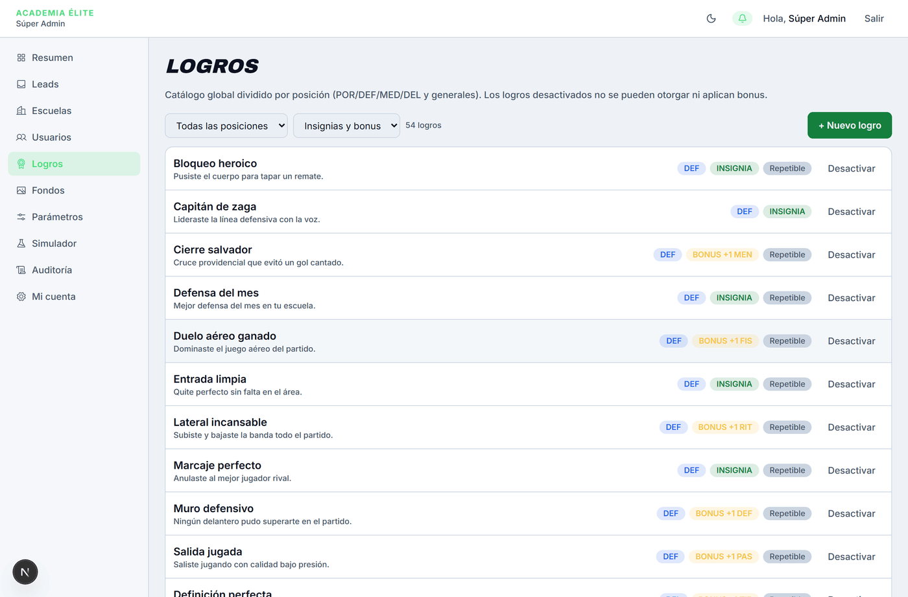
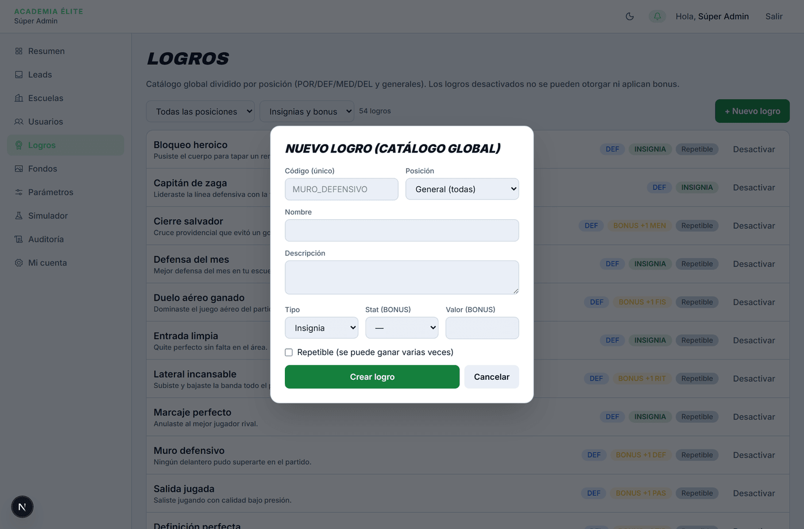

# Logros

> Verificado en la versión 0.1.0 (`6882787`) el 2026-10-19 por Agente de Manuales (Antigravity).

**Para qué sirve:** Es el catálogo maestro de incentivos deportivos donde el Súper Administrador crea, clasifica y gestiona todas las insignias de reconocimiento y bonus de rendimiento (físicos y técnicos) disponibles a nivel global para todas las escuelas de la plataforma.

**Quién lo usa y dónde está:** Súper Admin · Menú principal → **Logros**.

**Antes de empezar:** No se requieren datos previos; el sistema incluye un catálogo base preconfigurado de 52 logros divididos entre generales y posiciones específicas (porteros, defensas, mediocampistas y delanteros).

---

## Mapa de la pantalla

*Figura 1: Catálogo global de logros con filtros por posición y tipo, contadores y acciones de activación.*

*Figura 2: Formulario de alta para logros globales con configuración de posición, bonus y repetibilidad.*

---

## Controles

| N.º | Control (nombre exacto en pantalla) | Qué hace | Reglas y límites | Si se equivoca (mensaje literal) | Verificado |
|---|---|---|---|---|:---:|
| 1 | **Filtrar por posición** (lista desplegable) | Filtra la lista según la posición táctica destinataria del logro. | Opciones: `Todas las posiciones`, `Generales`, `POR`, `DEF`, `MED`, `DEL`. | N/A | Sí |
| 2 | **Filtrar por tipo** (lista desplegable) | Filtra según si el logro otorga insignia honorífica o incremento numérico en stats. | Opciones: `Insignias y bonus`, `Insignias`, `Bonus`. | N/A | Sí |
| 3 | **Contador de logros** (texto) | Informa en tiempo real la cantidad de logros visibles tras aplicar los filtros. | Texto descriptivo (p. ej. *"52 logros"*). | N/A | Sí |
| 4 | **+ Nuevo logro** (botón) | Abre un cuadro para registrar un nuevo logro en el catálogo global. | Botón primario en la esquina superior derecha. | N/A | Sí |
| 5 | **Código (único)** (campo) | Identificador único e inalterable, en mayúsculas (p. ej. `ESPIRITU_COMPETITIVO`). | Obligatorio. Longitud de 4 a 60 caracteres. Solo letras mayúsculas A-Z, números 0-9 y guión bajo `_`. | Si no cumple formato: *"Código inválido (A-Z, 0-9 y _)."* Si ya existe: *"Ya existe un logro con ese código."* | Sí |
| 6 | **Posición** (lista desplegable) | Restringe a qué rol en cancha aplica el logro. | Opciones: `General (todas)`, `POR`, `DEF`, `MED`, `DEL`. | N/A | Sí |
| 7 | **Nombre** (campo) | Nombre público que verán entrenadores y familias (p. ej. *"Espíritu Competitivo"*). | Obligatorio. Texto sin etiquetas ni código, de entre 3 y 80 caracteres. | Si está vacío o tiene menos de 3 caracteres: *"Nombre requerido."* | Sí |
| 8 | **Descripción** (campo de texto largo) | Detalle del mérito necesario para obtenerlo o motivación deportiva. | Obligatorio. Texto sin etiquetas ni código, de entre 5 y 200 caracteres. | Si está vacío o tiene menos de 5 caracteres: *"Descripción requerida."* | Sí |
| 9 | **Tipo** (lista desplegable) | Determina el beneficio: `Insignia` (honorífico en vitrina) o `Bonus` (suma a un atributo de carta). | Opciones: `Insignia`, `Bonus`. | N/A | Sí |
| 10 | **Stat (BONUS)** (lista desplegable) | Atributo de carta beneficiado por el bonus. | Opciones: `—`, `RIT`, `TIR`, `PAS`, `REG`, `DEF`, `FIS`, `MEN`. Obligatorio si el Tipo es Bonus. | Si Tipo es Bonus y se deja vacío: *"Un logro BONUS necesita stat y valor."* | Sí |
| 11 | **Valor (BONUS)** (campo) | Puntos netos que sumará el atributo en la siguiente evaluación. | Entero entre 1 y 3. Obligatorio si Tipo es Bonus. | El navegador solo acepta números enteros entre 1 y 3. Si se omite con Tipo Bonus: *"Un logro BONUS necesita stat y valor."* | Sí |
| 12 | **Repetible (se puede ganar varias veces)** (casilla) | Define si un jugador puede acumular este logro en múltiples ocasiones o una sola vez en su carrera. | Casilla que se marca o se desmarca. Por defecto desmarcada. | N/A | Sí |
| 13 | **Crear logro** (botón) | Valida y guarda el logro en el catálogo global. | Botón de envío. Mientras procesa cambia a *"Creando…"*. Si hay error, muestra un aviso rojo visible. | Mensaje de error específico de la regla que no se cumplió. | Sí |
| 14 | **Cancelar** (botón) | Descarta los datos ingresados y cierra el cuadro. | Botón secundario. | N/A | Sí |
| 15 | **Desactivar / Activar** (botón, en cada logro de la lista) | Habilita o inhabilita el logro para todo el sistema. | Al desactivar, el logro muestra un distintivo rojo *"Inactivo"*, los entrenadores no pueden otorgarlo y sus bonus pendientes quedan pausados. Al presionar *"Activar"*, recupera su vigencia inmediata. | N/A | Sí |

---

## Cómo se hace (tareas completas)

### Tarea 1: Crear un nuevo logro de insignia general

1. Inicia sesión con la cuenta de **Súper Administrador** y pulsa en **Logros** en el menú de navegación.
2. Pulsa en el botón verde **+ Nuevo logro** en la esquina superior derecha.
3. En el campo **Código (único)**, escribe un código en mayúsculas sin espacios (p. ej. `ESPIRITU_COMPETITIVO`).
4. En **Posición**, selecciona `General (todas)`.
5. En **Nombre**, ingresa el título público (p. ej. `Espíritu Competitivo`).
6. En **Descripción**, detalla el criterio de premiación (p. ej. `Demuestra entrega total y juego limpio en cada jugada.`).
7. En **Tipo**, mantén seleccionada la opción `Insignia`.
8. Si deseas que los alumnos puedan obtenerlo en distintas fechas, marca la casilla **Repetible (se puede ganar varias veces)**.
9. Pulsa en **Crear logro**.
10. **Resultado:** El cuadro se cierra automáticamente, el contador de logros se incrementa y el nuevo logro figura disponible en el catálogo global con su badge de posición `GEN` e `INSIGNIA`.

---

### Tarea 2: Crear un logro de tipo BONUS para una posición específica

1. Desde **Logros**, pulsa en **+ Nuevo logro**.
2. Escribe el código en mayúsculas (p. ej. `DISPARO_CERTERO_DEL`).
3. En **Posición**, selecciona `DEL` (Delanteros).
4. Asigna un nombre (p. ej. `Disparo Certero`) y su descripción correspondiente.
5. En **Tipo**, cambia la opción a `Bonus`.
6. En **Stat (BONUS)**, selecciona la estadística beneficiada (p. ej. `TIR`).
7. En **Valor (BONUS)**, escribe un incremento numérico (p. ej. `1`).
8. Pulsa en **Crear logro**.
9. **Resultado:** El logro queda registrado y muestra el distintivo dorado `BONUS +1 TIR` junto a la etiqueta táctica `DEL`.

---

### Tarea 3: Desactivar temporalmente un logro

1. En la lista de logros, localiza el ítem deseado (puedes utilizar los filtros de **Posición** o **Tipo** para hallarlo rápidamente).
2. Haz clic en el botón **Desactivar** ubicado a la derecha de la fila.
3. **Resultado:** La fila actualiza su estado de inmediato: aparece la etiqueta roja **Inactivo** y el botón conmuta su texto a **Activar**. A partir de este momento, los entrenadores ya no verán el logro como disponible para otorgar.

---

## Qué ve la otra parte

- **Entrenador (DT):** Al ingresar a **Logros** en su menú, los logros activos creados por el Súper Admin aparecen disponibles para ser programados en ventanas de fechas o concedidos a los alumnos. Los logros marcados como **Inactivos** desaparecen del catálogo operable del DT.
- **Familia y Jugador:** Los logros globales activos de tipo Insignia se visualizan en la vitrina de la pantalla **Logros** de la familia en estado bloqueado (con icono de candado) hasta que el entrenador se los otorga, momento en el cual se transforman en medallas doradas desbloqueadas.

---

## Errores y situaciones frecuentes

- **"Código inválido (A-Z, 0-9 y _).":** Ocurre si se ingresan letras minúsculas, tildes, caracteres especiales o espacios en blanco en el campo Código. Debe corregirse utilizando exclusivamente mayúsculas sostenidas y guiones bajos (p. ej. `DEFENSA_IMPECABLE`).
- **"Ya existe un logro con ese código.":** El código ingresado ya fue utilizado previamente en el catálogo global o por alguna escuela. Debe elegirse una clave diferente.
- **"Un logro BONUS necesita stat y valor.":** Aparece cuando se elige el tipo `Bonus` pero se omite seleccionar el stat (`RIT`, `TIR`, etc.) o el número de puntos a sumar.
- **Ningún logro coincide con los filtros:** Si se selecciona una combinación que no contiene registros (p. ej. un filtro restrictivo sin coincidencias), el sistema muestra un estado vacío con el icono de medalla y el mensaje *"Ningún logro coincide con los filtros."*. Basta con restablecer los desplegables a *"Todas las posiciones"* e *"Insignias y bonus"*.

---

## Notas internas

> Esta sección no se publica en el manual del usuario.

### Comportamientos conocidos

1. **Reinicio de campos tras error en formulario modal:** El formulario utiliza `useActionState` con campos no controlados. Ante un rechazo de validación devuelto por el servidor, React 19 limpia el contenido del formulario en el DOM, requiriendo que el administrador vuelva a completar los campos (hallazgo registrado en `10-MEJORAS.md` como MEJ-DOC-002).
2. **Edición de textos de logros sin control visible en la UI:** Aunque en el backend existe la acción `editarLogroAdminAction`, la pantalla actual solo ofrece el botón para alternar *"Activar / Desactivar"*. Las modificaciones al nombre o descripción de un logro ya creado deben solicitarse por soporte técnico.

### Referencias técnicas (movidas desde la capa pública)

- Rutas: catálogo global `/admin/logros`; vista del entrenador `/dt/logros`; vista de la familia `/jugador/logros`.
- Tipos de elemento de cada control: Filtrar por posición, Filtrar por tipo, Posición, Tipo y Stat (BONUS) son `select`; Contador de logros es texto; Código, Nombre y Valor (BONUS) son `input`; Descripción es `textarea`; Repetible es `checkbox`; los botones son `button`.
- **Valor (BONUS)**: validación HTML5 `min="1" max="3"`.
- **Nombre** y **Descripción** pasan por `textoSeguro()`. El mensaje de error de **Crear logro** viene del validador Zod y se pinta con `role="alert"`.
- Cuenta demo usada para verificar: `admin@demo.app`.

---

## Registro de verificación

- **Fecha:** 2026-10-19
- **Versión:** `0.1.0` (commit `6882787`)
- **Controles totales:** 15
- **Controles probados:** 15 (100% verificado en ejecución real)
- **Verificador:** Agente de Manuales (Antigravity) mediante Playwright Chromium automatizado contra base de datos demo.
